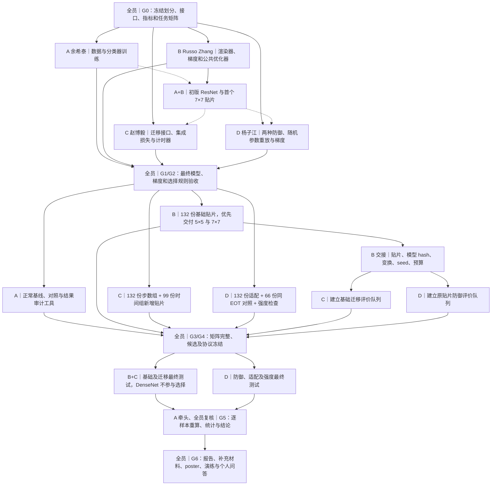

# Team 3：统一研究协议与验收标准

执行日期：2026-11-20。研究对象：CIFAR-10 图像分类器上的通用对抗贴片。代码路径、配置和命令为本计划规定的实现接口；创建并验收对应模块后执行。

## 1. 责任边界与要求映射

| 角色 | 成员 | 主责任 | 交叉复核 |
|---|---|---|---|
| A | 余希泰，xy195 | 数据、模型、公共评价、随机贴片与遮挡对照 | 复核 D 的评价分母与正常性能损失 |
| B | Russo Zhang，yz1047 | 贴片渲染、公共优化器、全部基础攻击 | 复核 C 的集成损失及模型冻结 |
| C | 赵博毅，bz138 | 基础迁移、集成优化、计算预算匹配 | 复核 A 的模型加载与配置一致性 |
| D | 杨子江，zy232 | 两种防御、适配攻击、攻击强度检查 | 复核 B 的梯度方向与采样方式 |

| 编号 | 必须形成的证据 | 实现责任 | 结果责任 |
|---|---|---|---|
| R01 | CIFAR-10 分类器上的原论文通用贴片生成过程 | B；A 提供模型 | B |
| R02 | 3×3、5×5、7×7、16×16 的非定向攻击 | B | B |
| R03 | 四种尺寸分别覆盖十个目标类别的定向攻击 | B | B |
| R04 | 贴片图案、成功与失败案例的观察分析 | B | B；全员复核 |
| R05 | 同一贴片直接迁移到 VGG、DenseNet；两种攻击类型均评价 | C | C |
| R06 | 扩展一：单源与双源集成优化的未参与优化架构迁移比较 | C | C |
| R07 | 扩展二：防御正常代价、非适配攻击、适配攻击 | D | D |
| R08 | 四人组至少两项扩展，明确且均衡的个人贡献 | 全员 | 全员 |
| R09 | 核心比较至少三次独立贴片优化初始化 | B、C、D | A 审计配置数量 |
| R10 | 正常准确率、攻击后准确率、统一 ASR 分母与样本数 | A | 全员使用同一评价器 |
| R11 | 纸质及 PDF poster、全员展示、个人问答 | 全员 | 全员 |
| R12 | 报告主体不超过六页，参考文献另计；详细结果放补充材料 | 全员 | 全员 |

R01—R05 来自选题基础要求；R06—R07 是已提交 proposal 中的两项扩展；R09 及下述具体数值是本研究的操作协议，不是课程另行规定的参数。

## 2. 研究问题与可支持的结论

1. **贴片效力与遮挡效应。** 在相同面积、位置和变换下，学习得到的纹理比随机贴片、恒定颜色遮挡增加了多少错误？
2. **通用性与迁移。** 在训练图片之外有效的同一贴片，能否迁移到另一固定分类器？集成优化的收益是否仍存在于预算匹配比较中？
3. **防御与攻击适配。** 防御削弱现成贴片时，正常准确率损失是多少？攻击者将防御纳入优化后，效果是否改变？

主结论范围为固定数据划分、指定模型 checkpoint、贴片空间与采样分布。三次贴片优化重复不能替代三次分类器训练；数字合成实验不能证明打印、拍摄条件下的物理有效性；实测攻击失败不能证明可认证鲁棒性。

## 3. 数据与模型冻结

### 3.1 数据划分

- 使用官方 CIFAR-10 Python 数据。类别顺序固定为 airplane、automobile、bird、cat、deer、dog、frog、horse、ship、truck，编号 0—9。
- 对官方 50,000 张训练图按类分层：每类 4,500 张训练、500 张验证，共 45,000/5,000；划分 seed 为 661。
- 官方 10,000 张测试图保持原顺序，每类 1,000 张。每个样本保留原始 split 与原始索引，不能混用 train_id 与 test_id。
- 分类器拟合与贴片优化只读取 45,000 张训练图；配置、checkpoint 选择和预算标定只读取验证集或训练集。
- 测试集只在协议和候选方法锁定后评价。测试结果不用于选目标类、调整防御、选择集成权重或挑最优贴片 seed。
- DenseNet 的正常验证准确率可以用于完成其监督训练；其贴片攻击结果不用于攻击方法的选择，包括验证集上的攻击表现。

划分使用固定版本 NumPy 的 `Generator(PCG64(661))`，按类别 0—9 顺序置乱该类升序原始索引，前 500 张为验证。优化选择用的 1,000 张验证子集按每类 100 张抽取，使用独立 `PCG64(662)`；保存抽取索引。验证变换 seed 固定为 6611，最终评价 seed 固定为 6610，每图均使用 8 次抽样。三者的随机流与贴片训练随机流分离。

### 3.2 输入契约

所有公共接口接收 `float32`、NCHW、形状 `[N,3,32,32]`、范围 `[0,1]` 的原始像素张量。完整预测为：

```text
原始图片 → 放置贴片 → 可选防御 → Normalize → 分类器 logits
```

Normalize 的均值和标准差仅用训练集原始像素计算并存储。模型包装器负责且仅负责一次归一化，返回 `[N,10]` 原始 logits。交叉熵直接接收 logits，不先做 softmax。验证和测试不做随机裁剪或水平翻转；贴片评价只应用协议规定的贴片变换及防御随机性。

### 3.3 模型定义

| 模型 | 固定实现 | 监督训练 seed | 攻击用途 |
|---|---|---|---|
| ResNet-20 | CIFAR 版；每阶段 3 个基本残差块；通道 16/32/64；Option A shortcut | 17 | B 主模型；C、D 的源模型 |
| VGG-11-BN-CIFAR | VGG A 配置的 8 个卷积层，BN；三个适配 CIFAR 的全连接层 | 17 | C 单源对照、集成的第二源、基础迁移目标 |
| DenseNet-BC-40-12 | 三个各含 6 个 bottleneck 的 dense block；growth=12，压缩率 0.5 | 17 | 只作最终迁移目标 |

记录网络结构、参数量、训练配置、验证选择规则、checkpoint SHA-256。正式攻击开始后不得用另一个同名模型替换 checkpoint。

## 4. 攻击空间、变换与对照

### 4.1 通用贴片

每个实验只有一个可学习张量 `p:[1,3,s,s]`，跨训练图片共享。定向实验每个目标类分别优化一个贴片；禁止评价时针对单张测试图片重新优化纹理。分类器参数、BatchNorm 统计量和 dropout 状态在攻击阶段冻结。

名义边长 `s∈{3,5,7,16}`，纹理像素约束 `[0,1]`。16×16 的名义面积占 32×32 图像的 25%；其他尺寸分别为 0.879%、2.441%、4.785%。这些百分比仅描述未变换正方形。

### 4.2 变换分布

主协议对每张图独立采样：旋转角度均匀分布于 `[-15°,15°]`，缩放因子均匀分布于 `[0.9,1.1]`，位置在完整容纳变换后支持区域的合法位置中均匀采样。超出边界的候选位置重采样，不通过裁掉贴片获得更小的有效攻击面积。

渲染器返回 `patched_images`、实际 alpha 遮罩和变换记录。记录每次的 `sum(alpha)`、`count(alpha>1e-6)` 及其除以 1024 后的比例；前者是有效混合面积，后者是支持面积。旋转与插值下二者可能不同。

使用预乘 alpha：先采样 `p*mask` 与 `mask`，合成为 `x*(1-alpha)+warped_premultiplied_patch`。不能对已预乘的纹理再乘一次 alpha，以免边界变暗；也不能把旋转外部的填充值当作贴片颜色写入背景。

初始单元检查使用无旋转、scale=1 的固定位置；这些检查不替代主协议的完整变换。无变换消融单独记录为 `transform=translation_only`，不得混入主表。

### 4.3 配对对照

对相同图片、同一遮罩、同一位置和变换，分别使用：无贴片、训练集均值颜色贴片、固定随机纹理、优化纹理。随机纹理只按 seed 生成一次，跨图片共享；不能每张图重新生成后称为同一个通用贴片。

对照使用相同的原始图像、插值和背景保留方式；不同方法间不能改变覆盖面积或把随机对照放到更不敏感的位置。

## 5. 优化与模型选择协议

| 项目 | 主配置 |
|---|---|
| 贴片优化器 | Adam，初始学习率 0.05，默认 betas，weight_decay=0 |
| 训练 batch | 128，所有源模型共享同一批图片和渲染结果 |
| 基础优化预算 | 1,000 次更新；验证只用于按预定规则选择贴片 |
| EOT 样本数 | B/C 每图每步 1 次；D 适配主配置每图每步 4 次联合采样 |
| 独立优化 seed | 101、102、103；分别控制纹理初始化、图片次序及变换 |
| 验证子集 | 验证集中按类固定抽取共 1,000 张；只决定优化过程中的候选选择 |
| 最终开发验证 | 完整 5,000 张验证图；不加入模型训练 |
| 正式评价 | 全部 10,000 测试图；每图 8 次联合变换抽样 |
| 选择频率 | 每 100 次更新检查一次固定验证子集；保存 step 0 和 step 1000 |
| 选择规则 | 单源：该源的 ASR；集成：两源 ASR 的算术平均；适配：对应防御下 ASR；同分取最早 step |

定向统一采用最小化 `CE(logits,target)`；非定向统一采用最小化 `-CE(logits,true_label)`。每步更新后在 `no_grad` 中将贴片 clamp 至 `[0,1]`。分类器前向本身不能处于 `no_grad` 或 `inference_mode`，因为梯度必须经分类器回传至贴片。

目标类别为 t 时，优化图片仍从统一训练集抽样；损失目标为 t。定向 ASR 的评价必须排除真实类为 t 的样本。各来源策略使用相同抽样规则，不能只给其中一个策略筛选更容易的图片。

上述优化参数先通过有限的开发验证：学习率只在 `{0.01,0.05}` 中检验，预算只在 `{500,1000}` 中检验。使用 7×7、目标类 3、seed 101 的开发任务与非定向任务完成可行性诊断；配置一旦冻结，按同一规则运行完整矩阵。不得把少数开发任务的表现当作全部任务的效果。

主矩阵保持 1,000 步。若梯度链路正常但验证曲线在 1,000 步仍持续改善，将 2,000 步作为明确命名的强度检查，不与主矩阵混成同一设置。不得根据测试集临时延长某个方法的预算。

## 6. 指标定义及分母

设测试样本 i 的真实标签为 y_i，未加防御的正常预测为 f(x_i)，定义固定基准集合：

```text
S_f   = {i : argmax f(x_i) = y_i}
S_f,t = {i in S_f : y_i != t}
```

每图第 j 次抽样的贴片预测记为 `pred_patch[i,j]`。j 同时包含贴片变换和随机防御抽样；不先多数投票。

```text
CleanAcc(f) = mean_i [pred_clean[i] == y_i]
PatchedAcc(f) = mean_(i,j) [pred_patch[i,j] == y_i]
UASR(f) = mean_(i in S_f,j) [pred_patch[i,j] != y_i]
TASR(f,t) = mean_(i in S_f,t,j) [pred_patch[i,j] == t]
```

方括号为 0/1 指示函数。分母为空时返回未定义及 `n_eligible=0`，不得写成 0% 或加入宏平均。

同一模型、相同 seed、目标类和尺寸的条件比较使用相同图片与抽样清单。跨模型各自的 S_f 不同，必须分别报告分母；C 的源策略比较统一在固定 DenseNet 的 S_f 或 S_f,t 上完成。

### 6.1 防御的额外指标

设 D 为防御。防御主表仍使用未防御模型的固定 S_f、S_f,t，以保持同组比较的分母一致，同时报告：

- `CleanAcc_D`：全测试集上 D(x) 的正常准确率。
- `PatchedAcc_D`：全测试集上 D(x_patch) 的准确率。
- `CleanDrop_pp = 100*(CleanAcc_f-CleanAcc_D)`：正常性能损失，单位为百分点。
- `DefenseOnlyError_Sf`：在 S_f 上，只有防御时的错误率。
- `NetErrorIncrease_Sf`：同图、同防御抽样下，贴片错误指示量减去只有防御时的错误指示量，再求平均。
- 定向对应的 `TargetRate_D_clean` 与 `NetTargetIncrease`。

非适配/适配 ASR、净错误增加和防御自身错误共同解释结果。不能把防御本身制造的错误全部归因于贴片。可另报仅在防御后仍正常正确样本上的指标，但须另列名称和分母，不替换主表。

### 6.2 自动一致性检查

1. 无贴片、无防御时，在 S_f 上 UASR=0，在 S_f,t 上 TASR=0。
2. 对同一个贴片、相同模型和 S_f,t，TASR 不大于该集合上的非定向错误率。
3. 对不同优化器分别生成的定向/非定向贴片，上述大小关系不构成必然约束。
4. `UASR=1-PatchedAcc` 只在相同 S_f 与相同抽样定义下成立，不能套用全测试集准确率。
5. 所有正确数不超过样本抽样对数，ASR 范围在 `[0,1]`；单图多次抽样不增加独立图片数。
6. 所有分条件结果可从逐样本记录重新计算，不能只保留汇总百分比。

## 7. 重复、统计与推断

- 每个主配置使用三个优化 seed，保留三份贴片和全部单独结果；汇总为均值与样本标准差，标准差使用 `ddof=1`。
- 十个目标类先分别计算 TASR，再等权宏平均。不能用分母加权的 pooled ASR 代替宏平均而不标识。
- 主要方法差异计算配对的百分点差：同模型、相同目标类、尺寸、seed、图片和抽样条件。
- 需要区间时，对逐图片的配对差做按真实类别分层的 bootstrap，2,000 次，seed 4242。每次以图片为单位保留该图片所有抽样，不能把 8 次随机变换当成 8 张独立图片。
- 此 bootstrap 默认先在固定的三个贴片 seed 上取配对平均，再重抽图片；每次重抽后重新计算各目标类的分母与宏平均。该区间只表达这些固定模型和贴片上的图片抽样不确定性；优化随机性的证据另以三 seed 的原始差值及标准差报告，不混称为总体训练随机性置信区间。
- 区间的推断范围为这些固定 checkpoint 和贴片重复。三次 seed 只提供有限的优化波动证据；不得凭此声称所有架构或训练随机性下均成立。
- 强度检查、单模型/集成、原贴片/适配贴片之间报告配对效应量。只展示单次最高结果不足以支持稳定改进结论。

## 8. 公共代码、数据结构与接口

建议代码结构：

```text
configs/                 protocol.yaml; models/; attacks/; defenses/
src/data.py              固定划分与 raw image loaders                         A
src/models/              resnet_cifar.py; vgg_cifar.py; densenet_cifar.py     A
src/model_bundle.py      唯一归一化入口、checkpoint 加载                     A
src/metrics.py           分母、逐样本指标、聚合                             A
src/patches/render.py    alpha 遮罩、仿射变换、放置                         B
src/patches/optimize.py  单源/集成/防御均复用的优化核心                     B
src/ensemble.py          多源平均损失、预算匹配                             C
src/defenses.py          模糊、随机缩放补边                                 D
scripts/                 prepare_data; train_classifier; optimize_patch;
                         evaluate_patch; run_matrix; benchmark_budget;
                         summarize_results; validate_artifacts
tests/                   数据、指标、梯度、模型冻结及预算的关键检查
artifacts/splits/        训练/验证索引与数据清单
artifacts/models/        权重、模型规格、归一化与 hash
artifacts/patches/       纹理、配置、优化日志与选择记录
results/raw/             逐样本、逐抽样记录
results/tables/          汇总表
results/figures/         导出的图表
```

公共函数契约：

```python
make_splits(labels, seed=661) -> SplitManifest
load_raw_dataset(split_manifest, split) -> Dataset  # 返回 image, label, image_id
load_model_bundle(path, device) -> ModelBundle       # 输入 raw，内部归一化
sample_patch_transforms(image_ids, draw_ids, seed, cfg) -> TransformBatch
apply_patch(images_raw, patch, transforms) -> (patched_raw, alpha, transform_meta)
apply_defense(images_raw, cfg, random_params) -> defended_raw
optimize_patch(source_bundles, objective, render_cfg, defense_cfg, budget_cfg) -> PatchArtifact
evaluate_patch(bundle, patch_artifact, eval_manifest, defense_cfg) -> RawEvaluation
aggregate_metrics(raw_evaluation, clean_reference) -> MetricRecord
```

`image_id` 和 `draw_id` 决定评价随机抽样，不能依赖 batch 顺序、GPU 数量或不同代码路径的 RNG 消耗次数。用稳定哈希派生局部 seed，不使用进程间不稳定的 Python `hash()`。

为初始化、训练图片次序、贴片变换、防御随机性、验证和可视化分别建立命名随机流。以规范化 UTF-8 字符串的 SHA-256 前 8 字节派生局部整数 seed，记录字节序与字段编码。比较 D 的适配/非适配组时，新增防御随机抽样不得改变训练图片或贴片变换序列；比较 C 三策略时，增加一个模型前向也不得改变抽样。

### 8.1 模型文件

```text
state_dict, architecture_name, architecture_config, num_classes,
normalization_mean, normalization_std, training_seed, split_sha256,
best_epoch, validation_metrics, training_config, software_versions,
code_commit, checkpoint_sha256
```

`checkpoint_sha256` 保存在外部 manifest 中，校验实际权重文件字节；不能要求文件内部保存该文件包含自身 hash 后的 hash。贴片文件和原始结果文件采用相同的外部校验方式。

### 8.2 贴片文件

```text
patch_tensor, nominal_size, objective, target_class,
source_model_names, source_checkpoint_hashes, source_loss_weights,
defense_config, transform_config, optimization_seed,
batch_size, optimizer_config, total_steps, selected_step,
eot_samples_per_image, wall_time_seconds, device_time_seconds,
forward_backward_calls, training_split_hash, selection_rule,
validation_history, protocol_hash, code_commit
```

### 8.3 逐样本文件与汇总表

逐样本文件至少有 `image_id, true_label, draw_id, pred_clean, pred_patch, pred_defense_clean, target_class, alpha_area, support_area` 及 run/model/patch/config hash；不适用字段使用明确空值。随机防御正常预测可按固定防御配置与抽样清单缓存。

汇总 CSV 至少有：

```text
run_id, phase, source_strategy, eval_model, checkpoint_hash,
patch_hash, size, objective, target, seed, defense, adaptive,
budget_type, optimizer_steps, eot_samples, wall_time_s,
clean_acc, patched_acc, uasr, tasr, n_images, n_eligible,
eval_draws, clean_drop_pp, net_error_increase, mean_alpha_area,
protocol_hash, code_commit
```

禁止把不同 checkpoint、不同攻击预算或不同评价分母的行自动合并。

## 9. 计算预算、运行记录与硬件

固定步骤比较与固定时间比较分开报告。计时前完成数据缓存、模型加载、代表性 forward/backward 预热和编译；正式优化计时包含渲染、防御、前后向、更新和必要同步。文件下载、首次编译、最终测试另报，不能只从某一个方法中扣除。

同一预算比较在同型号设备、相同进程数、batch、精度及后台负载条件下完成。记录实际时间及超时粒度。每 10 个更新检查一次时间预算时，允许的超额不超过一个检查区间，并按实际用时展示结果。

固定时间主预算累计训练更新区间；定期验证在计时器暂停并完成设备同步后进行，验证耗时单独累计。另报包含验证、保存和初始化的端到端耗时，防止把某个方法的验证开销隐藏在总成本之外。

在最终目标设备上先跑完整的“贴片→变换→防御→模型→贴片梯度”小实验。CUDA、MPS 与 TPU 的算子支持和同步方法分别验证。TPU 使用课程提供镜像与匹配后端；环境已能运行时保持版本固定。新建 TPU 环境依照官方 [PyTorch on Cloud TPU](https://docs.cloud.google.com/tpu/docs/pytorch-on-tpu) 选择后端，不直接套用旧的 XLA 安装命令。

若仿射采样的后向算子在目标设备不可用，采用等价的预计算坐标、四邻点 gather 和双线性权重实现，并与 CPU 参考的前向及梯度逐项比较。不得静默退回另一种攻击空间或大量 CPU 回退后仍报告 TPU 算力效率。

保存 Python、PyTorch、torchvision、设备后端及驱动版本，代码 commit 和依赖锁文件。固定各随机源；`grid_sample` 的部分设备后向具有非确定性，跨设备、跨版本不能据相同 seed 声称逐 bit 复现。CPU 确定性小样本用于梯度检查；正式实验报告真实重复波动。[复现文档](https://docs.pytorch.org/docs/stable/notes/randomness.html)，[grid_sample 文档](https://docs.pytorch.org/docs/stable/generated/torch.nn.functional.grid_sample.html)。

## 10. 主矩阵与验收数量

| 组别 | 贴片优化任务 | 数量 | 必须评价 |
|---|---|---:|---|
| B 基础 | 4 尺寸 × 11 任务 × 3 seeds | 132 | ResNet、VGG、DenseNet；后两者由 C 执行 |
| C 固定步数扩展 | VGG 单源与 R+V 集成 × 2 尺寸 × 11 任务 × 3 seeds | 132 个新增 | 各源与最终 DenseNet；R 单源 66 份复用 B |
| C 固定时间核心 | R 单源、V 单源、R+V × 7×7 × 11 任务 × 3 seeds | 99 | 同设备、同时间上限；DenseNet 只在最终评价使用 |
| D 适配主实验 | 2 防御 × 2 尺寸 × 11 任务 × 3 seeds | 132 个新增 | ResNet 上对应防御与固定无防御基准分母 |
| D 同 EOT 对照 | 不感知防御、EOT=4 × 2 尺寸 × 11 任务 × 3 seeds | 66 个新增 | 同一批贴片分别通过两种防御，与适配组配对 |
| D 非适配实验 | 直接复用 B 的 5×5、7×7 贴片 | 不新增优化 | 每种防御下均评价 |

主优化合计 561 次：B 132、C 231、D 198；不包括分类器训练、验证试跑和单独标识的强度诊断。D 的同 EOT 对照用于区分“纳入防御”与“增加抽样计算”的效果。主矩阵数量不等于评价次数。固定时间组不能因为参数相同就复用未达到相应时间预算的固定步数结果。

在完整运行前，以 50 个正式更新的实测中位耗时估算全部配置成本，并计入评价、三个模型训练、重复和余量；剩余额度从课程门户核实。执行优先级为：完整基础要求、两项扩展主比较、重复与强度验证、额外探索。不得以减少必要任务覆盖来隐藏预算不足。

## 11. 当前执行顺序与交接

| 日期，2026 | 全组交付 | 并行安排 |
|---|---|---|
| 11/20—11/21 | 协议、划分、接口和设备梯度链路通过 | A 建数据/模型；B 渲染/优化；C 多模型接口；D 防御接口 |
| 11/22—11/23 | 三个模型与公共评价器冻结；第一块 7×7 贴片 | A 正式训练；B 小规模攻击；C、D 用初版模型和贴片联调 |
| 11/24—11/26 | 基础矩阵运行并按批交接；扩展开始 | B 基础优化；C 直接迁移及集成；D 正常代价与适配 |
| 11/27—11/29 | 全部主配置、三 seeds、时间预算与强度诊断完成 | A 审计与对照；B 补齐矩阵；C、D 完成扩展 |
| 11/30—12/02 | 冻结后最终测试及全部逐样本结果 | DenseNet 首次正式攻击评价；四人执行各自结果核查 |
| 12/03—12/05 | 统计、主图、报告初稿 | 每人写本人方法与结果并交叉复核 |
| 12/06—12/08 | poster 定稿打印、报告整合、全员演练 | 每人解释全流程与本人贡献 |
| 12/09 13:00—16:00 | 现场展示与个人问答 | 携带纸质 poster；每人交流评价至少三个 poster |
| 12/10—12/11 | 整理反馈、最终报告与补充材料 | 12/11 23:59 美东时间前提交 |

开始时先盘点实际已完成成果；有文件、配置和核查记录的工作可直接进入对应验收门，不能仅凭口头状态跳过。

交接门依次为：G0 数据与协议固定；G1 梯度/指标正确；G2 模型和开发选择规则固定；G3 主矩阵和诊断完整；G4 候选与评价协议冻结；G5 最终结果可重算；G6 poster、报告、问答准备完成。发现实现错误后更正代码并重跑全部受影响条件，保留错误与更正记录；不把修复结果与旧条件混合。

## 12. 报告与展示的证据结构

主报告建议用六页分配：动机与研究问题约 0.6 页，方法与威胁模型 1.3 页，实验协议 0.8 页，基础攻击 0.8 页，集成扩展 0.8 页，防御扩展 1.0 页，局限与结论 0.5 页；留约 0.2 页排版余量。参考文献另计，完整目标类表、全部 seeds、额外诊断和复现命令放补充材料。

主图至少包括：尺寸—ASR 曲线、目标类热力图、随机/遮挡/学习贴片对照、迁移矩阵、预算匹配的集成效果、防御正常损失及适配前后比较。图注写明模型、尺寸、目标聚合、分母、重复和误差条含义。

六分钟展示按约 45 秒问题、75 秒方法与协议、60 秒基础结果、60 秒集成、75 秒防御、45 秒结论组织；每人承担一段并参与问答准备。个人答辩必须解释自己的代码、对照、失败案例和结论边界。

课程评分比例：proposal 10%、poster 15%、展示 15%、个人问答 20%、最终报告 40%。Poster 使用课程模板；报告使用课程论文模板，代码与许可文件随仓库整理。现场每人至少交流三个 poster 并提交评价表；全组另从其他组中投选最佳 poster，用三句话同时概括项目、说明优势并给出选择理由。以上要求来源于课程材料，与本计划新增的实验控制区分执行。

## 13. 当前实施流程与并行关系

实线表示必须完成的前置交付；虚线表示可提前开展的原型联调。并行分支可同时开发，正式训练仍按设备和余额调度。



| 交接 | 提供者 → 接收者 | 最低内容 | 接收验收 |
|---|---|---|---|
| 数据与公共模型 | A → B/C/D | split、Normalize、ModelBundle、模型 hash、正常验证记录 | raw 输入一致；参数冻结；输入梯度存在 |
| 渲染与优化核心 | B → C/D | 固定坐标约定、alpha、EOT、损失符号、seed 流、预算接口 | 同一渲染可复用；集成和防御梯度正确 |
| 基础贴片 | B → C/D | 张量、目标、尺寸、seed、selected step、配置及文件 hash | 不修改纹理即可加载并重建条件 |
| 集成与时间组 | C → A/全员 | 全部策略结果、计时边界、实际时间、步数、调用量 | 无 DenseNet 调参；等步数/等时间分开 |
| 防御与适配组 | D → A/全员 | 防御选择、正常代价、三路径、强度组、随机抽样记录 | 固定分母；同 EOT；正常与攻击配对 |
| 统计及提交材料 | 全员 → 全员 | 可重算主表、图注、六页报告、补充材料、poster | 无缺失目标/seed；结论不超出证据 |
