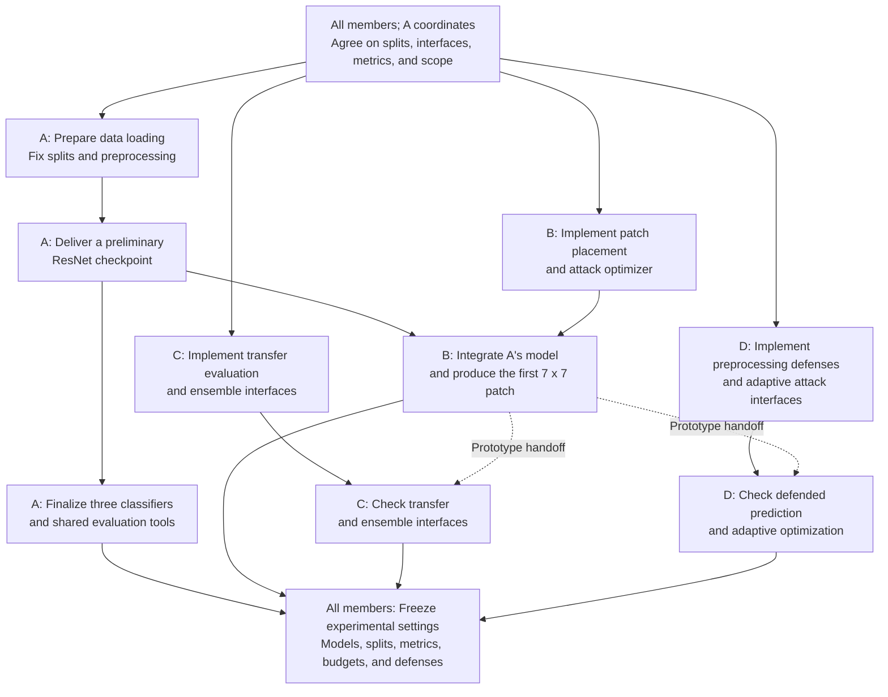
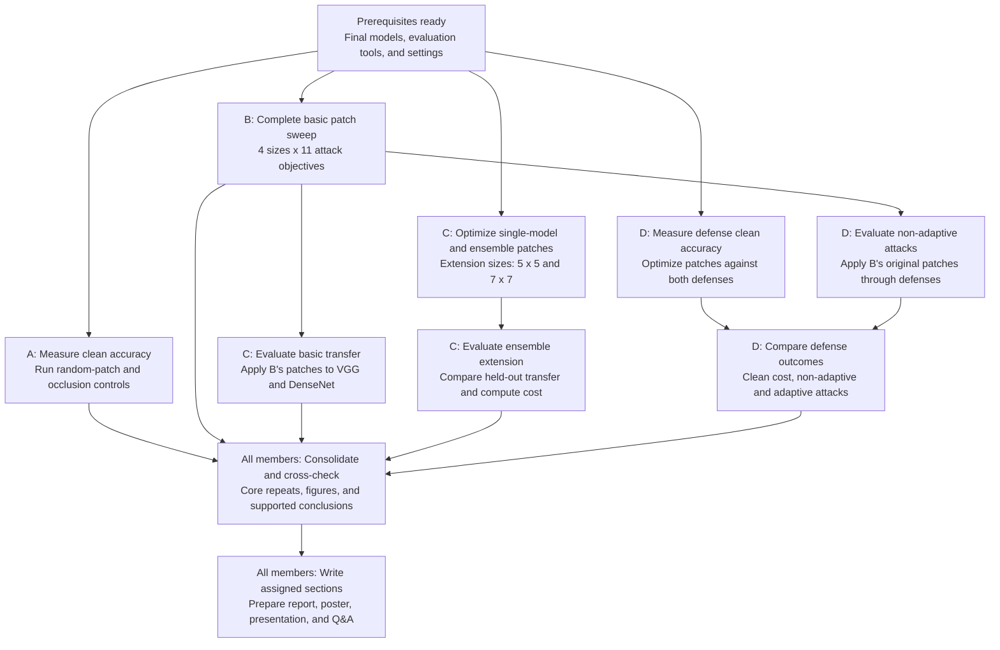
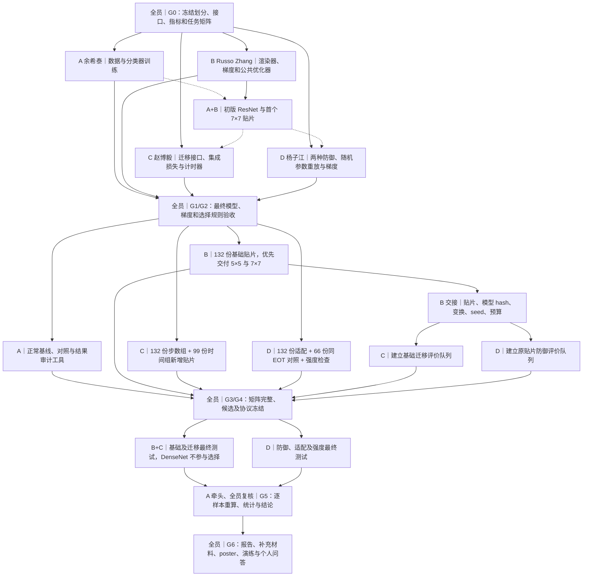

# ECE661 Team 3：完整研究与分步实施计划书

**选题：** Project 5 — Adversarial Patch Attack  
**项目：** Universal Adversarial Patches on CIFAR-10: Transferability and Adaptive Defense Evaluation  
**计划版本：** 2026-11-20  
**小组：** Team 3，四人

| 角色 | 成员 | 主要工作 |
|---|---|---|
| A | 余希泰（xy195） | 数据、三个分类器、公共评价、遮挡与随机对照、结果审计 |
| B | Russo Zhang（yz1047） | 可微贴片渲染、共享优化器、全部基础攻击与图案分析 |
| C | 赵博毅（bz138） | 基础跨模型迁移、集成扩展、等步数与等时间比较 |
| D | 杨子江（zy232） | 两种预处理防御、适配攻击、同 EOT 对照与强度诊断 |

## 内容导航

1. [选题原文与课程交付要求](#topic-and-requirements)
2. [Proposal：研究正文全文、参考文献与流程附录](#proposal)
3. [统一研究协议、矩阵与实施流程](#shared-protocol)
4. [A：数据、模型、公共评价与对照](#part-a)
5. [B：通用贴片与完整基础实验](#part-b)
6. [C：迁移、集成与计算预算](#part-c)
7. [D：防御、适配与可靠性](#part-d)
8. [主要技术依据与最终归档](#references-and-deliverables)

<a id="topic-and-requirements"></a>

## 1. 选题原文与课程交付要求

### 1.1 Project 5 原文

来源：[ECE661 Project Topic List-26FA.pdf，第 6 页](/Users/russozhang/Downloads/ECE661%20Project%20Topic%20List-26FA.pdf)。以下保留原文文字与原参考链接。


---

> Project 5: Adversarial Patch Attack
>
> Project description
> Previously we have studied the adversarial attacks, which are realized by crafting pixel -wise
> additive perturbations that are constrained by L-p norm bound. These attacks, as you may notice,
> are not that feasible in the real -world (can you really add  small noises to a physical object?). In
> contrast, there is another type of adversarial attacks that are designed to be “physical” –
> Adversarial Patch attack. As its name suggests, the idea is to create a patch (or a sticker) that
> can be attached to somewhere in the image to fool the classifier. In this project, you will act as an
> attacker and craft such adversarial patches to mislead neural networks.
>
> Basic Requirement
> ● Implement the Adversarial Patch generation process described in [1] for CIFAR-10
> classifiers. For simplicity you can generate rectangular patches instead of circular ones.
> ● Evaluate the effect of patch size. For example, generate patches with the size 3x3, 5x5,
> 7x7, 16x16, and measure the untargeted attack success rate (ASR) as a function of the
> patch size. Are there any visual patterns you could see in the generated patches?
> ● A careful attacker may want to disrupt the model in a way that whenever the patch is
> there the model will predict a certain target class. Repeat step 2 but this time focus on
> the targeted attack success rate. Try using each of the 10 classes as the target class.
> How does targeted ASR compared to untargeted ASR? Are there any visual patterns
> when generating targeted patches?
> ● Transfer the generated patches on one model to others, e.g., from ResNet to DenseNet
> or VGG. Measure the untargeted/targeted ASR. To what extent do the patches transfer
> across different models?
>
> Optional Requirement (Choose the one you are interested)
> ● Your own idea
>
> References
> 1. Brown et al., “Adversarial Patch,” (https://arxiv.org/pdf/2002.05709.pdf)

---


原文参考链接 `2002.05709` 指向其他论文。实际实现与引用使用 Brown 等人的 [Adversarial Patch，arXiv:1712.09665](https://arxiv.org/abs/1712.09665)。

### 1.2 课程要求与本组执行范围

| 项目 | 课程要求 | 本组执行 |
|---|---|---|
| 基础工作 | 完成选题全部 basic requirements | 四尺寸、非定向、十个定向目标、图案分析、迁移到 VGG 与 DenseNet |
| 四人组 | 工作量均衡；四人组至少两项 optional exploration，要求更高 | C：集成与计算匹配；D：防御与适配；A/B 提供完整基线及核心实现 |
| Proposal | Heilmeier Catechism 结构；通过 Canvas 提交 | 下节保留六项问题的完整研究正文及其参考文献、流程附录 |
| Poster | 使用课程 poster 模板，PDF 与纸质版本 | 四人共同完成，纸质版带至现场 |
| 展示 | 2026-12-09 13:00—16:00，必须到场 | 约 6 分钟展示、3.5 分钟问答、0.5 分钟切换，四人均参与 |
| 问答 | 根据个人贡献单独提问及评分 | 每人掌握本部分方法、代码、对照、结果与局限 |
| 同行交流 | 每位学生与至少三个 poster 交流并提交评价表 | 各自提交；全组另投选其他组最佳 poster 并提交三句话理由 |
| 报告 | 课程论文模板；PDF；主体不超过六页，参考文献另计 | 包含摘要、引言、相关研究、方法、实验和结论；完整表与诊断放独立补充材料 |
| 代码 | 课程强烈推荐提交支持报告的代码与开源许可 | 整理可复验代码、配置、依赖、产物索引和许可 |
| 截止 | 最终报告 2026-12-11 23:59，美东时间 | 按当前实施时间表完成审计与提交 |
| 资源 | 每组课程总额度最高 $250 | 开始完整矩阵前核实剩余额度并实测训练、优化、验证与评价成本 |
| 评分 | proposal 10%、poster 15%、展示 15%、问答 20%、报告 40% | 用完整实验、受控比较、可重算证据和准确答辩支持各项交付 |

课程要求来源：[Project Guidelines](/Users/russozhang/Downloads/ECE661%20Project%20Guidelines-26FA.pdf) 第 1—4 页；[Project List Presentation](/Users/russozhang/Downloads/2026FA_Project_List_Presentation.pdf) 第 3—5、8、10 页。下文规定的具体 seed、学习率、EOT 数量、强度阈值和实验数量属于本组研究协议。

<a id="proposal"></a>

## 2. Proposal：研究正文全文、参考文献与流程附录

Proposal 日期为 2026-10-25。本节保留原研究设计与当时的里程碑；当前执行顺序、参数和验收以第 3—7 节为准。


---

**Universal Adversarial Patches on CIFAR-10: Transferability and Adaptive Defense Evaluation**


**Course:** ECE 661, Fall 2026  
**Selected topic:** Project 5 - Adversarial Patch Attack  
**Group:** Team 3  
**Team members:** 余希泰 (xy195), Member A; Russo Zhang (yz1047), Member B; 赵博毅 (bz138), Member C; 杨子江 (zy232), Member D  
**Proposal date:** October 25, 2026

### 1. What are we trying to do?

We will investigate how a small, shared image patch can cause CIFAR-10 classifiers to make incorrect predictions. Unlike an image-specific perturbation, a universal patch is optimized across training images and evaluated on previously unseen images. Our goal is to characterize the relationship between patch area, target class, model transferability, and defense effectiveness through reproducible experiments.

Our project will address three research questions:

1. **Attack effectiveness:** How do patch size and target class affect targeted and untargeted attack success, relative to ordinary occlusion?
2. **Transferability:** Does optimizing a patch jointly against multiple source models improve its effectiveness against a held-out architecture under comparable computational budgets?
3. **Defense evaluation:** How much do simple preprocessing defenses reduce attack success, and how does their apparent benefit change when patch optimization accounts for the defense?

Our four-person team will complete all basic requirements and two extensions: **ensemble-based patch optimization** and **preprocessing defenses evaluated with adaptive attacks**. Our contribution is a controlled empirical study of established methods on CIFAR-10.

### 2. How is it done today?

Brown et al. [1] introduced universal adversarial patches optimized over images, placements, and transformations. Their expectation-over-transformation approach encourages a patch to remain effective under changes such as translation, rotation, and scaling. The paper also investigates ensemble optimization and transfer across models.

Preprocessing can change an attack's effectiveness, but reduced success against an existing attack is insufficient to establish robustness. Athalye et al. [2] demonstrate that defenses can appear effective when they interfere with attack optimization, motivating evaluations in which the attacker accounts for the defended prediction pipeline.

We will adapt these ideas to small CIFAR-10 classifiers and study them under consistent data splits, attack settings, and evaluation metrics. This setting allows us to examine both attack performance and the cost of obtaining it within the course's resource limits.

### 3. What is our approach, and why do we think it will be successful?

#### 3.1 Data, models, and experimental scope

We will use CIFAR-10 [3] at its original 32 x 32 resolution. We will create a fixed, stratified split of the official training set into 45,000 training images and 5,000 validation images, and reserve the official 10,000 test images for final evaluation. Classifier fitting and patch optimization will use only training images; hyperparameter selection and early stopping will use validation images.

We will train a ResNet-20 as the primary source classifier, a CIFAR-adapted VGG-11 with batch normalization, and a DenseNet-BC with depth 40 and growth rate 12. DenseNet will serve as the held-out architecture for the ensemble extension: its attack results will not guide patch optimization, ensemble weights, or hyperparameter selection. We will report classifier configurations and clean accuracy so attack results can be interpreted against model quality.

Experiments will use shared data splits, preprocessing, patch-placement rules, and evaluation code. Patches will be applied in pixel space before model normalization. We will document the nominal patch dimensions, transformation distribution, and actual coverage after transformation, and use matched settings across comparisons.

#### 3.2 Basic requirements: universal patch attacks

Following [1], we will optimize a shared patch while freezing classifier parameters. Let $A(p,x,\tau)$ apply patch $p$ to image $x$ with sampled placement and transformation $\tau$. For target class $t$, we will minimize

$$
\mathcal{L}_{\mathrm{target}}(p)
=\mathbb{E}_{(x,y),\tau}\left[\mathrm{CE}\bigl(f(A(p,x,\tau)),t\bigr)\right].
$$

For untargeted attacks, we will maximize cross-entropy with the true label. Patch pixels will remain within the valid image range, and classifier parameters and normalization statistics will remain fixed during patch optimization.

We will evaluate nominal patch sizes of **3 x 3, 5 x 5, 7 x 7, and 16 x 16**, including untargeted attacks and targeted attacks for each of the ten classes. This produces 44 primary-source configurations per patch initialization. All resulting patches will also be evaluated on VGG and DenseNet to measure transferability. We will compare optimized patches with same-area random patches and constant-color occlusions using matched placements and transformations, and visualize learned patterns and representative failures.

#### 3.3 Extension 1: ensemble optimization and transferability

We will compare patches optimized against ResNet alone, VGG alone, and an equal-weight average of the two models' attack losses. DenseNet will remain outside the optimization process. The extension will cover 5 x 5 and 7 x 7 patches, both attack types, and all ten targeted classes.

We hypothesize that jointly optimizing against two architectures may reduce dependence on source-specific features and improve held-out transfer. We will test this hypothesis rather than assume an improvement. Because each ensemble step requires additional computation, we will report optimization steps and elapsed time and include a comparison under matched elapsed-time budgets on the same hardware. Optimization budgets will be calibrated on validation data and fixed before final evaluation.

#### 3.4 Extension 2: preprocessing defenses and adaptive attacks

We will investigate mild Gaussian blur and random resizing with padding. For each defense, we will measure clean accuracy, evaluate patches optimized without the defense, and then optimize new patches through the complete defended pipeline. Defense parameters will be selected on validation data and fixed before final testing.

For randomized preprocessing, adaptive optimization will estimate the expected loss over independently sampled defense transformations. Evaluation will likewise average success over repeated random draws. The defended predictor will perform one sampled preprocessing operation per prediction; repeated evaluation draws will estimate its behavior rather than introduce a separate voting defense.

We will examine whether reduced attack success persists after adaptation, together with the defense's clean-accuracy cost. For core configurations, we will increase attack iterations, restarts, or transformation samples to check whether weak optimization explains apparent robustness. Our conclusions will be empirical and restricted to the tested setting.

#### 3.5 Evaluation and reproducibility

For classifier $f$, define the eligible set $S_f=\{(x,y):f(x)=y\}$. Untargeted ASR will be the fraction of this set misclassified after patch application. Targeted ASR for class $t$ will use $S_{f,t}=\{(x,y)\in S_f:y\ne t\}$ and measure the fraction predicted as $t$. We will report eligible sample counts, per-target results, and macro-averages across targets.

Defense comparisons will retain the same eligibility sets defined by the corresponding classifier without preprocessing. We will additionally report clean and patched accuracy over the full test set, making clean-performance losses visible. Randomized quantities will be estimated over repeated draws with the sampling procedure recorded.

Core comparisons will use at least three independent patch initializations, with means and variability reported. These repeats measure patch-optimization variability; claims about variability across independently trained classifiers will require separate model retraining. We will preserve checkpoints, patches, configurations, seeds, raw metrics, and timing records, and provide commands for reproducing the main tables and figures.

#### 3.6 Team responsibilities

| Member | Main responsibility | Concrete deliverables |
|---|---|---|
| **A: 余希泰 (xy195)** | Data, classifier baselines, shared evaluation, and result auditing | Fixed splits; three model checkpoints and configurations; clean-accuracy and occlusion-control tables; validated metrics |
| **B: Russo Zhang (yz1047)** | Universal patch implementation and basic experiments | Targeted and untargeted optimization; complete size/class sweep; saved patches; attack curves and qualitative examples |
| **C: 赵博毅 (bz138)** | Transfer evaluation and ensemble extension | Basic cross-model transfer results; ensemble optimizer; held-out transfer and compute-budget comparisons |
| **D: 杨子江 (zy232)** | Preprocessing defenses and adaptive evaluation | Defense modules; clean-performance costs; adaptive patch optimization; defense and attack-strength comparisons |

Each member will write the methods and analysis for their experiments and review another member's results. A preliminary model and one working patch will be shared early so transfer and defense work can proceed before the full basic sweep is complete. All members will participate in poster preparation, presentation, and Q&A preparation.

### 4. What are the risks?

| Risk | Planned response |
|---|---|
| Small patches or targeted transfer achieve low ASR | Verify gradients and loss direction on a pilot; compare with occlusion controls; diagnose optimization on validation data; report failures alongside successful cases. |
| Ensemble gains come mainly from additional computation | Report both fixed-step and matched-time comparisons with the same data and transformation settings. |
| A defense appears robust because the attack is poorly optimized | Optimize through the defense, account for randomness, and check stronger attack budgets and independent restarts. |
| Classifier training and experiment sweeps exceed available resources | Benchmark early, reuse frozen models, batch evaluation, and prioritize the full basic matrix and the two defined extensions over additional ablations. |
| Evaluation choices produce misleading comparisons | Share metric code, record ASR denominators, preserve full-test accuracy, and keep test data out of configuration selection. |

The experiments will use public CIFAR-10 images and models controlled by the team. We will collect no new personal data, attribute reused code and methods, and limit conclusions to this digital benchmark.

### 5. How long will it take, and what resources are needed?

Implementation, experimentation, and analysis will run from October 25 through November 29, followed by presentation and report preparation.

| Dates, 2026 | Milestone |
|---|---|
| **Oct. 25-26** | Finalize interfaces and data splits, complete feasibility checks, and submit the proposal by Oct. 26, 11:59 p.m. Eastern Time. |
| **Oct. 27-Nov. 8** | Complete classifier baselines and the main patch implementation; run the basic attack and transfer matrix. |
| **Nov. 9-16** | Obtain initial ensemble and defense results; prepare the optional Nov. 16 TA check-in. |
| **Nov. 17-29** | Complete adaptive attacks, budget-matched comparisons, core repeats, and attack-strength checks. |
| **Nov. 30-Dec. 8** | Audit results, finalize figures, prepare the poster and report, and rehearse the presentation. |
| **Dec. 9** | Attend the in-person poster session, 1:00-4:00 p.m. Eastern Time. |
| **Dec. 10-11** | Incorporate feedback and submit the final report by Dec. 11, 11:59 p.m. Eastern Time. |

The project requires accelerator access for three CIFAR-scale classifiers and patch optimization, with storage for checkpoints and logs. We will use the course compute allocation within the group budget of up to $250. Runtime measurements will guide scheduling and resource use.

### 6. What are the final "exams" for success?

The project will be successful if we can deliver reproducible evidence addressing all three research questions, including negative findings where appropriate. Specifically, we will provide:

1. **Basic study:** all four sizes, untargeted attacks, ten targeted classes, patch visualizations, and cross-model transfer.
2. **Ensemble study:** held-out transfer and compute-matched single-model comparisons.
3. **Defense study:** clean-accuracy costs, non-adaptive attacks, and adaptive attacks.
4. **Reproducibility:** models, patches, configurations, seeds, metrics, timing logs, and documented execution commands.
5. **Presentation and report:** printed/PDF poster, all-member presentation, and a final report within the course page limit, with supplementary material.

Expected outputs include patch-size curves, target-class heatmaps, transfer matrices, and defense comparisons. Conclusions will be supported by measured results, including negative findings.

### References

1. Tom B. Brown, Dandelion Mané, Aurko Roy, Martín Abadi, and Justin Gilmer. **Adversarial Patch.** arXiv:1712.09665, 2017. [Paper](https://arxiv.org/abs/1712.09665).
2. Anish Athalye, Nicholas Carlini, and David Wagner. **Obfuscated Gradients Give a False Sense of Security: Circumventing Defenses to Adversarial Examples.** ICML, 2018. [Paper](https://arxiv.org/abs/1802.00420).
3. Alex Krizhevsky. **Learning Multiple Layers of Features from Tiny Images.** Technical report, 2009. [CIFAR-10 dataset and report](https://cave.cs.toronto.edu/kriz/cifar.html).

### Appendix. Workflow and dependencies

Solid arrows indicate prerequisite deliveries; dashed arrows indicate early prototype handoffs. Independent branches can proceed concurrently within the available compute capacity. Roles A-D correspond to the named team members in Section 3.6.

**Stage 1: Development and integration.** A delivers an initial ResNet checkpoint while completing the three final classifiers. B shares the first working 7 x 7 patch so C and D can check their pipelines before the basic sweep is complete.



**Stage 2: Experiments and evaluation.** With models and settings finalized, controls, basic attacks, ensemble optimization, and adaptive optimization proceed in parallel. C and D receive B's original patches in batches for transfer and non-adaptive defense evaluation.



C's ensemble optimization and D's adaptive optimization do not require B's full sweep. Each handoff includes model and patch files, preprocessing, objective, size, transformations, seed, and optimization budget. Final measurements use fixed settings; DenseNet attack results do not guide method selection.

---

<a id="shared-protocol"></a>

## 3. 统一研究协议、矩阵与实施流程

**Team 3：统一研究协议与验收标准**


执行日期：2026-11-20。研究对象：CIFAR-10 图像分类器上的通用对抗贴片。代码路径、配置和命令为本计划规定的实现接口；创建并验收对应模块后执行。

### 1. 责任边界与要求映射

| 角色 | 成员 | 主责任 | 交叉复核 |
|---|---|---|---|
| A | 余希泰，xy195 | 数据、模型、公共评价、随机贴片与遮挡对照 | 复核 D 的评价分母与正常性能损失 |
| B | Russo Zhang，yz1047 | 贴片渲染、公共优化器、全部基础攻击 | 复核 C 的集成损失及模型冻结 |
| C | 赵博毅，bz138 | 基础迁移、集成优化、计算预算匹配 | 复核 A 的模型加载与配置一致性 |
| D | 杨子江，zy232 | 两种防御、适配攻击、攻击强度检查 | 复核 B 的梯度方向与采样方式 |

| 编号 | 必须形成的证据 | 实现责任 | 结果责任 |
|---|---|---|---|
| R01 | CIFAR-10 分类器上的原论文通用贴片生成过程 | B；A 提供模型 | B |
| R02 | 3×3、5×5、7×7、16×16 的非定向攻击 | B | B |
| R03 | 四种尺寸分别覆盖十个目标类别的定向攻击 | B | B |
| R04 | 贴片图案、成功与失败案例的观察分析 | B | B；全员复核 |
| R05 | 同一贴片直接迁移到 VGG、DenseNet；两种攻击类型均评价 | C | C |
| R06 | 扩展一：单源与双源集成优化的未参与优化架构迁移比较 | C | C |
| R07 | 扩展二：防御正常代价、非适配攻击、适配攻击 | D | D |
| R08 | 四人组至少两项扩展，明确且均衡的个人贡献 | 全员 | 全员 |
| R09 | 核心比较至少三次独立贴片优化初始化 | B、C、D | A 审计配置数量 |
| R10 | 正常准确率、攻击后准确率、统一 ASR 分母与样本数 | A | 全员使用同一评价器 |
| R11 | 纸质及 PDF poster、全员展示、个人问答 | 全员 | 全员 |
| R12 | 报告主体不超过六页，参考文献另计；详细结果放补充材料 | 全员 | 全员 |

R01—R05 来自选题基础要求；R06—R07 是已提交 proposal 中的两项扩展；R09 及下述具体数值是本研究的操作协议，不是课程另行规定的参数。

### 2. 研究问题与可支持的结论

1. **贴片效力与遮挡效应。** 在相同面积、位置和变换下，学习得到的纹理比随机贴片、恒定颜色遮挡增加了多少错误？
2. **通用性与迁移。** 在训练图片之外有效的同一贴片，能否迁移到另一固定分类器？集成优化的收益是否仍存在于预算匹配比较中？
3. **防御与攻击适配。** 防御削弱现成贴片时，正常准确率损失是多少？攻击者将防御纳入优化后，效果是否改变？

主结论范围为固定数据划分、指定模型 checkpoint、贴片空间与采样分布。三次贴片优化重复不能替代三次分类器训练；数字合成实验不能证明打印、拍摄条件下的物理有效性；实测攻击失败不能证明可认证鲁棒性。

### 3. 数据与模型冻结

#### 3.1 数据划分

- 使用官方 CIFAR-10 Python 数据。类别顺序固定为 airplane、automobile、bird、cat、deer、dog、frog、horse、ship、truck，编号 0—9。
- 对官方 50,000 张训练图按类分层：每类 4,500 张训练、500 张验证，共 45,000/5,000；划分 seed 为 661。
- 官方 10,000 张测试图保持原顺序，每类 1,000 张。每个样本保留原始 split 与原始索引，不能混用 train_id 与 test_id。
- 分类器拟合与贴片优化只读取 45,000 张训练图；配置、checkpoint 选择和预算标定只读取验证集或训练集。
- 测试集只在协议和候选方法锁定后评价。测试结果不用于选目标类、调整防御、选择集成权重或挑最优贴片 seed。
- DenseNet 的正常验证准确率可以用于完成其监督训练；其贴片攻击结果不用于攻击方法的选择，包括验证集上的攻击表现。

划分使用固定版本 NumPy 的 `Generator(PCG64(661))`，按类别 0—9 顺序置乱该类升序原始索引，前 500 张为验证。优化选择用的 1,000 张验证子集按每类 100 张抽取，使用独立 `PCG64(662)`；保存抽取索引。验证变换 seed 固定为 6611，最终评价 seed 固定为 6610，每图均使用 8 次抽样。三者的随机流与贴片训练随机流分离。

#### 3.2 输入契约

所有公共接口接收 `float32`、NCHW、形状 `[N,3,32,32]`、范围 `[0,1]` 的原始像素张量。完整预测为：

```text
原始图片 → 放置贴片 → 可选防御 → Normalize → 分类器 logits
```

Normalize 的均值和标准差仅用训练集原始像素计算并存储。模型包装器负责且仅负责一次归一化，返回 `[N,10]` 原始 logits。交叉熵直接接收 logits，不先做 softmax。验证和测试不做随机裁剪或水平翻转；贴片评价只应用协议规定的贴片变换及防御随机性。

#### 3.3 模型定义

| 模型 | 固定实现 | 监督训练 seed | 攻击用途 |
|---|---|---|---|
| ResNet-20 | CIFAR 版；每阶段 3 个基本残差块；通道 16/32/64；Option A shortcut | 17 | B 主模型；C、D 的源模型 |
| VGG-11-BN-CIFAR | VGG A 配置的 8 个卷积层，BN；三个适配 CIFAR 的全连接层 | 17 | C 单源对照、集成的第二源、基础迁移目标 |
| DenseNet-BC-40-12 | 三个各含 6 个 bottleneck 的 dense block；growth=12，压缩率 0.5 | 17 | 只作最终迁移目标 |

记录网络结构、参数量、训练配置、验证选择规则、checkpoint SHA-256。正式攻击开始后不得用另一个同名模型替换 checkpoint。

### 4. 攻击空间、变换与对照

#### 4.1 通用贴片

每个实验只有一个可学习张量 `p:[1,3,s,s]`，跨训练图片共享。定向实验每个目标类分别优化一个贴片；禁止评价时针对单张测试图片重新优化纹理。分类器参数、BatchNorm 统计量和 dropout 状态在攻击阶段冻结。

名义边长 `s∈{3,5,7,16}`，纹理像素约束 `[0,1]`。16×16 的名义面积占 32×32 图像的 25%；其他尺寸分别为 0.879%、2.441%、4.785%。这些百分比仅描述未变换正方形。

#### 4.2 变换分布

主协议对每张图独立采样：旋转角度均匀分布于 `[-15°,15°]`，缩放因子均匀分布于 `[0.9,1.1]`，位置在完整容纳变换后支持区域的合法位置中均匀采样。超出边界的候选位置重采样，不通过裁掉贴片获得更小的有效攻击面积。

渲染器返回 `patched_images`、实际 alpha 遮罩和变换记录。记录每次的 `sum(alpha)`、`count(alpha>1e-6)` 及其除以 1024 后的比例；前者是有效混合面积，后者是支持面积。旋转与插值下二者可能不同。

使用预乘 alpha：先采样 `p*mask` 与 `mask`，合成为 `x*(1-alpha)+warped_premultiplied_patch`。不能对已预乘的纹理再乘一次 alpha，以免边界变暗；也不能把旋转外部的填充值当作贴片颜色写入背景。

初始单元检查使用无旋转、scale=1 的固定位置；这些检查不替代主协议的完整变换。无变换消融单独记录为 `transform=translation_only`，不得混入主表。

#### 4.3 配对对照

对相同图片、同一遮罩、同一位置和变换，分别使用：无贴片、训练集均值颜色贴片、固定随机纹理、优化纹理。随机纹理只按 seed 生成一次，跨图片共享；不能每张图重新生成后称为同一个通用贴片。

对照使用相同的原始图像、插值和背景保留方式；不同方法间不能改变覆盖面积或把随机对照放到更不敏感的位置。

### 5. 优化与模型选择协议

| 项目 | 主配置 |
|---|---|
| 贴片优化器 | Adam，初始学习率 0.05，默认 betas，weight_decay=0 |
| 训练 batch | 128，所有源模型共享同一批图片和渲染结果 |
| 基础优化预算 | 1,000 次更新；验证只用于按预定规则选择贴片 |
| EOT 样本数 | B/C 每图每步 1 次；D 适配主配置每图每步 4 次联合采样 |
| 独立优化 seed | 101、102、103；分别控制纹理初始化、图片次序及变换 |
| 验证子集 | 验证集中按类固定抽取共 1,000 张；只决定优化过程中的候选选择 |
| 最终开发验证 | 完整 5,000 张验证图；不加入模型训练 |
| 正式评价 | 全部 10,000 测试图；每图 8 次联合变换抽样 |
| 选择频率 | 每 100 次更新检查一次固定验证子集；保存 step 0 和 step 1000 |
| 选择规则 | 单源：该源的 ASR；集成：两源 ASR 的算术平均；适配：对应防御下 ASR；同分取最早 step |

定向统一采用最小化 `CE(logits,target)`；非定向统一采用最小化 `-CE(logits,true_label)`。每步更新后在 `no_grad` 中将贴片 clamp 至 `[0,1]`。分类器前向本身不能处于 `no_grad` 或 `inference_mode`，因为梯度必须经分类器回传至贴片。

目标类别为 t 时，优化图片仍从统一训练集抽样；损失目标为 t。定向 ASR 的评价必须排除真实类为 t 的样本。各来源策略使用相同抽样规则，不能只给其中一个策略筛选更容易的图片。

上述优化参数先通过有限的开发验证：学习率只在 `{0.01,0.05}` 中检验，预算只在 `{500,1000}` 中检验。使用 7×7、目标类 3、seed 101 的开发任务与非定向任务完成可行性诊断；配置一旦冻结，按同一规则运行完整矩阵。不得把少数开发任务的表现当作全部任务的效果。

主矩阵保持 1,000 步。若梯度链路正常但验证曲线在 1,000 步仍持续改善，将 2,000 步作为明确命名的强度检查，不与主矩阵混成同一设置。不得根据测试集临时延长某个方法的预算。

### 6. 指标定义及分母

设测试样本 i 的真实标签为 y_i，未加防御的正常预测为 f(x_i)，定义固定基准集合：

```text
S_f   = {i : argmax f(x_i) = y_i}
S_f,t = {i in S_f : y_i != t}
```

每图第 j 次抽样的贴片预测记为 `pred_patch[i,j]`。j 同时包含贴片变换和随机防御抽样；不先多数投票。

```text
CleanAcc(f) = mean_i [pred_clean[i] == y_i]
PatchedAcc(f) = mean_(i,j) [pred_patch[i,j] == y_i]
UASR(f) = mean_(i in S_f,j) [pred_patch[i,j] != y_i]
TASR(f,t) = mean_(i in S_f,t,j) [pred_patch[i,j] == t]
```

方括号为 0/1 指示函数。分母为空时返回未定义及 `n_eligible=0`，不得写成 0% 或加入宏平均。

同一模型、相同 seed、目标类和尺寸的条件比较使用相同图片与抽样清单。跨模型各自的 S_f 不同，必须分别报告分母；C 的源策略比较统一在固定 DenseNet 的 S_f 或 S_f,t 上完成。

#### 6.1 防御的额外指标

设 D 为防御。防御主表仍使用未防御模型的固定 S_f、S_f,t，以保持同组比较的分母一致，同时报告：

- `CleanAcc_D`：全测试集上 D(x) 的正常准确率。
- `PatchedAcc_D`：全测试集上 D(x_patch) 的准确率。
- `CleanDrop_pp = 100*(CleanAcc_f-CleanAcc_D)`：正常性能损失，单位为百分点。
- `DefenseOnlyError_Sf`：在 S_f 上，只有防御时的错误率。
- `NetErrorIncrease_Sf`：同图、同防御抽样下，贴片错误指示量减去只有防御时的错误指示量，再求平均。
- 定向对应的 `TargetRate_D_clean` 与 `NetTargetIncrease`。

非适配/适配 ASR、净错误增加和防御自身错误共同解释结果。不能把防御本身制造的错误全部归因于贴片。可另报仅在防御后仍正常正确样本上的指标，但须另列名称和分母，不替换主表。

#### 6.2 自动一致性检查

1. 无贴片、无防御时，在 S_f 上 UASR=0，在 S_f,t 上 TASR=0。
2. 对同一个贴片、相同模型和 S_f,t，TASR 不大于该集合上的非定向错误率。
3. 对不同优化器分别生成的定向/非定向贴片，上述大小关系不构成必然约束。
4. `UASR=1-PatchedAcc` 只在相同 S_f 与相同抽样定义下成立，不能套用全测试集准确率。
5. 所有正确数不超过样本抽样对数，ASR 范围在 `[0,1]`；单图多次抽样不增加独立图片数。
6. 所有分条件结果可从逐样本记录重新计算，不能只保留汇总百分比。

### 7. 重复、统计与推断

- 每个主配置使用三个优化 seed，保留三份贴片和全部单独结果；汇总为均值与样本标准差，标准差使用 `ddof=1`。
- 十个目标类先分别计算 TASR，再等权宏平均。不能用分母加权的 pooled ASR 代替宏平均而不标识。
- 主要方法差异计算配对的百分点差：同模型、相同目标类、尺寸、seed、图片和抽样条件。
- 需要区间时，对逐图片的配对差做按真实类别分层的 bootstrap，2,000 次，seed 4242。每次以图片为单位保留该图片所有抽样，不能把 8 次随机变换当成 8 张独立图片。
- 此 bootstrap 默认先在固定的三个贴片 seed 上取配对平均，再重抽图片；每次重抽后重新计算各目标类的分母与宏平均。该区间只表达这些固定模型和贴片上的图片抽样不确定性；优化随机性的证据另以三 seed 的原始差值及标准差报告，不混称为总体训练随机性置信区间。
- 区间的推断范围为这些固定 checkpoint 和贴片重复。三次 seed 只提供有限的优化波动证据；不得凭此声称所有架构或训练随机性下均成立。
- 强度检查、单模型/集成、原贴片/适配贴片之间报告配对效应量。只展示单次最高结果不足以支持稳定改进结论。

### 8. 公共代码、数据结构与接口

建议代码结构：

```text
configs/                 protocol.yaml; models/; attacks/; defenses/
src/data.py              固定划分与 raw image loaders                         A
src/models/              resnet_cifar.py; vgg_cifar.py; densenet_cifar.py     A
src/model_bundle.py      唯一归一化入口、checkpoint 加载                     A
src/metrics.py           分母、逐样本指标、聚合                             A
src/patches/render.py    alpha 遮罩、仿射变换、放置                         B
src/patches/optimize.py  单源/集成/防御均复用的优化核心                     B
src/ensemble.py          多源平均损失、预算匹配                             C
src/defenses.py          模糊、随机缩放补边                                 D
scripts/                 prepare_data; train_classifier; optimize_patch;
                         evaluate_patch; run_matrix; benchmark_budget;
                         summarize_results; validate_artifacts
tests/                   数据、指标、梯度、模型冻结及预算的关键检查
artifacts/splits/        训练/验证索引与数据清单
artifacts/models/        权重、模型规格、归一化与 hash
artifacts/patches/       纹理、配置、优化日志与选择记录
results/raw/             逐样本、逐抽样记录
results/tables/          汇总表
results/figures/         导出的图表
```

公共函数契约：

```python
make_splits(labels, seed=661) -> SplitManifest
load_raw_dataset(split_manifest, split) -> Dataset  # 返回 image, label, image_id
load_model_bundle(path, device) -> ModelBundle       # 输入 raw，内部归一化
sample_patch_transforms(image_ids, draw_ids, seed, cfg) -> TransformBatch
apply_patch(images_raw, patch, transforms) -> (patched_raw, alpha, transform_meta)
apply_defense(images_raw, cfg, random_params) -> defended_raw
optimize_patch(source_bundles, objective, render_cfg, defense_cfg, budget_cfg) -> PatchArtifact
evaluate_patch(bundle, patch_artifact, eval_manifest, defense_cfg) -> RawEvaluation
aggregate_metrics(raw_evaluation, clean_reference) -> MetricRecord
```

`image_id` 和 `draw_id` 决定评价随机抽样，不能依赖 batch 顺序、GPU 数量或不同代码路径的 RNG 消耗次数。用稳定哈希派生局部 seed，不使用进程间不稳定的 Python `hash()`。

为初始化、训练图片次序、贴片变换、防御随机性、验证和可视化分别建立命名随机流。以规范化 UTF-8 字符串的 SHA-256 前 8 字节派生局部整数 seed，记录字节序与字段编码。比较 D 的适配/非适配组时，新增防御随机抽样不得改变训练图片或贴片变换序列；比较 C 三策略时，增加一个模型前向也不得改变抽样。

#### 8.1 模型文件

```text
state_dict, architecture_name, architecture_config, num_classes,
normalization_mean, normalization_std, training_seed, split_sha256,
best_epoch, validation_metrics, training_config, software_versions,
code_commit, checkpoint_sha256
```

`checkpoint_sha256` 保存在外部 manifest 中，校验实际权重文件字节；不能要求文件内部保存该文件包含自身 hash 后的 hash。贴片文件和原始结果文件采用相同的外部校验方式。

#### 8.2 贴片文件

```text
patch_tensor, nominal_size, objective, target_class,
source_model_names, source_checkpoint_hashes, source_loss_weights,
defense_config, transform_config, optimization_seed,
batch_size, optimizer_config, total_steps, selected_step,
eot_samples_per_image, wall_time_seconds, device_time_seconds,
forward_backward_calls, training_split_hash, selection_rule,
validation_history, protocol_hash, code_commit
```

#### 8.3 逐样本文件与汇总表

逐样本文件至少有 `image_id, true_label, draw_id, pred_clean, pred_patch, pred_defense_clean, target_class, alpha_area, support_area` 及 run/model/patch/config hash；不适用字段使用明确空值。随机防御正常预测可按固定防御配置与抽样清单缓存。

汇总 CSV 至少有：

```text
run_id, phase, source_strategy, eval_model, checkpoint_hash,
patch_hash, size, objective, target, seed, defense, adaptive,
budget_type, optimizer_steps, eot_samples, wall_time_s,
clean_acc, patched_acc, uasr, tasr, n_images, n_eligible,
eval_draws, clean_drop_pp, net_error_increase, mean_alpha_area,
protocol_hash, code_commit
```

禁止把不同 checkpoint、不同攻击预算或不同评价分母的行自动合并。

### 9. 计算预算、运行记录与硬件

固定步骤比较与固定时间比较分开报告。计时前完成数据缓存、模型加载、代表性 forward/backward 预热和编译；正式优化计时包含渲染、防御、前后向、更新和必要同步。文件下载、首次编译、最终测试另报，不能只从某一个方法中扣除。

同一预算比较在同型号设备、相同进程数、batch、精度及后台负载条件下完成。记录实际时间及超时粒度。每 10 个更新检查一次时间预算时，允许的超额不超过一个检查区间，并按实际用时展示结果。

固定时间主预算累计训练更新区间；定期验证在计时器暂停并完成设备同步后进行，验证耗时单独累计。另报包含验证、保存和初始化的端到端耗时，防止把某个方法的验证开销隐藏在总成本之外。

在最终目标设备上先跑完整的“贴片→变换→防御→模型→贴片梯度”小实验。CUDA、MPS 与 TPU 的算子支持和同步方法分别验证。TPU 使用课程提供镜像与匹配后端；环境已能运行时保持版本固定。新建 TPU 环境依照官方 [PyTorch on Cloud TPU](https://docs.cloud.google.com/tpu/docs/pytorch-on-tpu) 选择后端，不直接套用旧的 XLA 安装命令。

若仿射采样的后向算子在目标设备不可用，采用等价的预计算坐标、四邻点 gather 和双线性权重实现，并与 CPU 参考的前向及梯度逐项比较。不得静默退回另一种攻击空间或大量 CPU 回退后仍报告 TPU 算力效率。

保存 Python、PyTorch、torchvision、设备后端及驱动版本，代码 commit 和依赖锁文件。固定各随机源；`grid_sample` 的部分设备后向具有非确定性，跨设备、跨版本不能据相同 seed 声称逐 bit 复现。CPU 确定性小样本用于梯度检查；正式实验报告真实重复波动。[复现文档](https://docs.pytorch.org/docs/stable/notes/randomness.html)，[grid_sample 文档](https://docs.pytorch.org/docs/stable/generated/torch.nn.functional.grid_sample.html)。

### 10. 主矩阵与验收数量

| 组别 | 贴片优化任务 | 数量 | 必须评价 |
|---|---|---:|---|
| B 基础 | 4 尺寸 × 11 任务 × 3 seeds | 132 | ResNet、VGG、DenseNet；后两者由 C 执行 |
| C 固定步数扩展 | VGG 单源与 R+V 集成 × 2 尺寸 × 11 任务 × 3 seeds | 132 个新增 | 各源与最终 DenseNet；R 单源 66 份复用 B |
| C 固定时间核心 | R 单源、V 单源、R+V × 7×7 × 11 任务 × 3 seeds | 99 | 同设备、同时间上限；DenseNet 只在最终评价使用 |
| D 适配主实验 | 2 防御 × 2 尺寸 × 11 任务 × 3 seeds | 132 个新增 | ResNet 上对应防御与固定无防御基准分母 |
| D 同 EOT 对照 | 不感知防御、EOT=4 × 2 尺寸 × 11 任务 × 3 seeds | 66 个新增 | 同一批贴片分别通过两种防御，与适配组配对 |
| D 非适配实验 | 直接复用 B 的 5×5、7×7 贴片 | 不新增优化 | 每种防御下均评价 |

主优化合计 561 次：B 132、C 231、D 198；不包括分类器训练、验证试跑和单独标识的强度诊断。D 的同 EOT 对照用于区分“纳入防御”与“增加抽样计算”的效果。主矩阵数量不等于评价次数。固定时间组不能因为参数相同就复用未达到相应时间预算的固定步数结果。

在完整运行前，以 50 个正式更新的实测中位耗时估算全部配置成本，并计入评价、三个模型训练、重复和余量；剩余额度从课程门户核实。执行优先级为：完整基础要求、两项扩展主比较、重复与强度验证、额外探索。不得以减少必要任务覆盖来隐藏预算不足。

### 11. 当前执行顺序与交接

| 日期，2026 | 全组交付 | 并行安排 |
|---|---|---|
| 11/20—11/21 | 协议、划分、接口和设备梯度链路通过 | A 建数据/模型；B 渲染/优化；C 多模型接口；D 防御接口 |
| 11/22—11/23 | 三个模型与公共评价器冻结；第一块 7×7 贴片 | A 正式训练；B 小规模攻击；C、D 用初版模型和贴片联调 |
| 11/24—11/26 | 基础矩阵运行并按批交接；扩展开始 | B 基础优化；C 直接迁移及集成；D 正常代价与适配 |
| 11/27—11/29 | 全部主配置、三 seeds、时间预算与强度诊断完成 | A 审计与对照；B 补齐矩阵；C、D 完成扩展 |
| 11/30—12/02 | 冻结后最终测试及全部逐样本结果 | DenseNet 首次正式攻击评价；四人执行各自结果核查 |
| 12/03—12/05 | 统计、主图、报告初稿 | 每人写本人方法与结果并交叉复核 |
| 12/06—12/08 | poster 定稿打印、报告整合、全员演练 | 每人解释全流程与本人贡献 |
| 12/09 13:00—16:00 | 现场展示与个人问答 | 携带纸质 poster；每人交流评价至少三个 poster |
| 12/10—12/11 | 整理反馈、最终报告与补充材料 | 12/11 23:59 美东时间前提交 |

开始时先盘点实际已完成成果；有文件、配置和核查记录的工作可直接进入对应验收门，不能仅凭口头状态跳过。

交接门依次为：G0 数据与协议固定；G1 梯度/指标正确；G2 模型和开发选择规则固定；G3 主矩阵和诊断完整；G4 候选与评价协议冻结；G5 最终结果可重算；G6 poster、报告、问答准备完成。发现实现错误后更正代码并重跑全部受影响条件，保留错误与更正记录；不把修复结果与旧条件混合。

### 12. 报告与展示的证据结构

主报告建议用六页分配：动机与研究问题约 0.6 页，方法与威胁模型 1.3 页，实验协议 0.8 页，基础攻击 0.8 页，集成扩展 0.8 页，防御扩展 1.0 页，局限与结论 0.5 页；留约 0.2 页排版余量。参考文献另计，完整目标类表、全部 seeds、额外诊断和复现命令放补充材料。

主图至少包括：尺寸—ASR 曲线、目标类热力图、随机/遮挡/学习贴片对照、迁移矩阵、预算匹配的集成效果、防御正常损失及适配前后比较。图注写明模型、尺寸、目标聚合、分母、重复和误差条含义。

六分钟展示按约 45 秒问题、75 秒方法与协议、60 秒基础结果、60 秒集成、75 秒防御、45 秒结论组织；每人承担一段并参与问答准备。个人答辩必须解释自己的代码、对照、失败案例和结论边界。

课程评分比例：proposal 10%、poster 15%、展示 15%、个人问答 20%、最终报告 40%。Poster 使用课程模板；报告使用课程论文模板，代码与许可文件随仓库整理。现场每人至少交流三个 poster 并提交评价表；全组另从其他组中投选最佳 poster，用三句话同时概括项目、说明优势并给出选择理由。以上要求来源于课程材料，与本计划新增的实验控制区分执行。

### 13. 当前实施流程与并行关系

实线表示必须完成的前置交付；虚线表示可提前开展的原型联调。并行分支可同时开发，正式训练仍按设备和余额调度。



| 交接 | 提供者 → 接收者 | 最低内容 | 接收验收 |
|---|---|---|---|
| 数据与公共模型 | A → B/C/D | split、Normalize、ModelBundle、模型 hash、正常验证记录 | raw 输入一致；参数冻结；输入梯度存在 |
| 渲染与优化核心 | B → C/D | 固定坐标约定、alpha、EOT、损失符号、seed 流、预算接口 | 同一渲染可复用；集成和防御梯度正确 |
| 基础贴片 | B → C/D | 张量、目标、尺寸、seed、selected step、配置及文件 hash | 不修改纹理即可加载并重建条件 |
| 集成与时间组 | C → A/全员 | 全部策略结果、计时边界、实际时间、步数、调用量 | 无 DenseNet 调参；等步数/等时间分开 |
| 防御与适配组 | D → A/全员 | 防御选择、正常代价、三路径、强度组、随机抽样记录 | 固定分母；同 EOT；正常与攻击配对 |
| 统计及提交材料 | 全员 → 全员 | 可重算主表、图注、六页报告、补充材料、poster | 无缺失目标/seed；结论不超出证据 |

---

<a id="part-a"></a>

## 4. A：余希泰（xy195）详细计划书

**A 详细计划书：数据、分类器、公共评价与对照**


负责人：余希泰（xy195）。执行依据：[统一研究协议](00_Shared_Research_Protocol.md)。

### A.1 研究目标与交付边界

A 负责建立可审计的实验基准：正常分类器具有合理性能，贴片与防御使用相同输入含义，ASR 的分母清楚，任意汇总数字均能从逐样本记录重算。A 的研究分析集中在模型质量、遮挡效应与评价公平性。

交付文件包括 `SplitManifest`、三个 `ModelBundle`、归一化规格、统一评价器、随机/恒色对照、正常准确率与模型规格表、指标单元检查和矩阵审计结果。

### A.2 第一步：建立实验目录与版本记录

1. 在仓库根目录创建共享协议规定的 `configs/、src/、scripts/、tests/、artifacts/、results/`。
2. 创建 `configs/protocol.yaml`，写入 45,000/5,000/10,000 划分、seed 661、三个模型、贴片 seed 101/102/103、尺寸、目标类、变换和评价抽样规则。
3. 保存环境记录：Python、PyTorch、torchvision、设备后端、驱动、操作系统和精度；导出依赖锁文件。
4. 用短实验测量模型 forward/backward 与输入梯度，不把能正常分类视为贴片反向已被支持。
5. 与 B 确认输入为 raw `[0,1]`；与 C 确认多源共用渲染图；与 D 确认防御在 Normalize 之前。

验收：四人的同一张 raw 图经过同一个模型包装器时，logits 在同设备同精度下相同或处于已记录的浮点容差内；环境与配置文件可定位到同一 commit。

### A.3 第二步：实现固定、分层且可复验的数据划分

实现 `src/data.py` 与 `scripts/prepare_data.py`：

1. 下载并校验官方 CIFAR-10 文件；保留官方 train/test 划分和原始类别顺序。
2. 为每类训练索引独立打乱，取 500 为验证，剩余 4,500 为训练。保存整数索引，不保存仅能在某次 DataLoader 顺序中成立的位置。
3. 验证 train、val 互斥，并集等于全部 50,000 训练样本；每类数量准确；test 索引全部来自官方测试集。
4. 在训练 raw 像素上按通道累计 `sum(x)、sum(x²)、n_pixels`，以 float64 累计，计算均值与总体标准差。不得把逐图片标准差简单平均当成整体标准差。
5. 保存数据版本、类别映射、索引列表、统计量和 SHA-256。
6. 创建三种 loader：监督训练 loader、贴片优化 loader、验证/测试 loader。监督训练可裁剪翻转；贴片优化读取未裁剪背景，仅由 B 的渲染器加入贴片变换；正式评价保持原始图片。

监督增强固定为四周 padding 4 后随机裁剪至 32×32，再以 0.5 概率水平翻转。增强只发生在监督训练支路。每个 loader 返回 `image_raw、label、image_id`。

验收：

- train/val/test 数量为 45,000/5,000/10,000，且 class counts 分别为每类 4,500/500/1,000。
- 重新运行划分脚本得到相同清单 hash。
- 验证和测试连续读取同一索引得到相同 raw 张量；标签与官方样例相符。
- Normalize 只应用一次；均值、标准差及图像 dtype/range 在日志中可见。

### A.4 第三步：实现并核对三个分类器

#### A.4.1 ResNet-20

采用原论文 CIFAR 结构的 6n+2 定义，n=3：[结构依据](https://arxiv.org/abs/1512.03385)。

| 部分 | 结构 | 输出形状，忽略 batch |
|---|---|---|
| Stem | 3×3 conv，3→16，stride 1，padding 1；BN；ReLU | 16×32×32 |
| Stage 1 | 3 个基本块，每块 3×3 conv-BN-ReLU、3×3 conv-BN、残差相加-ReLU | 16×32×32 |
| Stage 2 | 3 个块；首块首卷积 stride 2，通道变 32 | 32×16×16 |
| Stage 3 | 3 个块；首块首卷积 stride 2，通道变 64 | 64×8×8 |
| Head | 全局均值池化；Linear(64,10) | 10 logits |

卷积不使用 bias，BN 使用可训练 affine。Option A shortcut 用步长为 2 的空间下采样和通道零填充，不加入学习型 1×1 投影。按此定义可训练参数量应为 269,722；若不同，逐层核对 bias、投影、BN 和分类头。不能用 torchvision 的 ResNet-18 替代后继续标为 ResNet-20。

#### A.4.2 VGG-11-BN-CIFAR

按 VGG A 配置构建卷积骨干：[结构依据](https://arxiv.org/abs/1409.1556)。

```text
Conv64-BN-ReLU, MaxPool2
Conv128-BN-ReLU, MaxPool2
Conv256-BN-ReLU, Conv256-BN-ReLU, MaxPool2
Conv512-BN-ReLU, Conv512-BN-ReLU, MaxPool2
Conv512-BN-ReLU, Conv512-BN-ReLU, MaxPool2
Flatten
Linear512→512, ReLU, Dropout0.5
Linear512→512, ReLU, Dropout0.5
Linear512→10
```

所有卷积为 3×3、padding 1；五次池化使空间分辨率从 32 降到 1。该适配结构保留 8 个卷积层和 3 个全连接层。记录 CIFAR 分类头的规格，不将其描述为原版 ImageNet 4096 维分类头。

#### A.4.3 DenseNet-BC-40-12

实现 bottleneck 与 transition compression：[结构依据](https://arxiv.org/abs/1608.06993)。

- 起始 3×3 conv 输出 24 通道，不做 ImageNet 大步长 stem。
- 每个 dense block 含 6 个 bottleneck。每个 bottleneck 为 BN-ReLU-1×1 conv 输出 48 通道，再 BN-ReLU-3×3 conv 输出 12 通道，与输入在通道维拼接。
- 第一块输出 96 通道；transition 以 1×1 conv 压缩到 48，再 2×2 均值池化。
- 第二块输出 120；transition 压缩到 60，再均值池化。
- 第三块输出 132；最后 BN-ReLU、全局均值池化、Linear(132,10)。
- 深度按初始卷积、36 个块内卷积、2 个 transition 卷积、1 个分类层计为 40。

两个 transition 都按 BN-ReLU-1×1 conv-2×2 AvgPool 实现。DenseNet 卷积不带 bias，BN 使用 affine，dense block 不额外加 dropout；全连接分类头保留 bias。将这些选项写入 architecture_config，避免不同实现都被同一个简称覆盖。

验收：三个模型输入 `[4,3,32,32]` 均输出有限的 `[4,10]` logits；参数量与各层 shape 自动打印。DenseNet 的拼接顺序、compression 向下取整和最后通道数需有独立检查。

### A.5 第四步：监督训练与 checkpoint 选择

本研究的初始训练配置为：200 epochs、batch 128、SGD、momentum 0.9、weight decay 5e-4、初始学习率 0.1、cosine 衰减至 0。每 epoch 完成训练更新后推进学习率调度；验证不更新模型。

执行顺序：

1. 先用固定 32 张训练图关闭增强进行小样本拟合，确认损失能降低、模型有能力拟合标签；该调试模型不用于正式结果。
2. 跑 1 个完整 epoch 检查设备、样本数、数据范围、学习率、loss 和验证流程。
3. 优先启动正式 ResNet-20，尽早向 B 提供可加载的初版 checkpoint；明确其不是最终结果版本。
4. 继续完成三个模型训练，每 epoch 保存验证 loss/accuracy、每类正确数和耗时。
5. 以完整验证集准确率选择 checkpoint；同分取较早 epoch。测试集不参与挑选。
6. 若初始学习率造成发散，按照预先限制的候选 0.05 在验证集重训并完整记录；不进行无界超参数搜索。
7. 正常验证性能明显不合理时，先检查输入归一化、标签、网络结构、scheduler 与训练模式，再扩展训练。必须区分训练失败与模型真的容易受攻击。

模型选择后，将权重与归一化参数打包，计算 checkpoint hash。向 C 提供两个源模型；DenseNet 的权重仅用于最终目标模型加载及正常训练核查，攻击配置开发不读取其攻击反馈。

### A.6 第五步：公共预测与冻结接口

实现 `src/model_bundle.py`：

```python
class ModelBundle:
    # 保存 architecture、state_dict、normalization 和 provenance
    def predict_logits(self, images_raw):
        # images_raw: float32, NCHW, [0,1]
        x = (images_raw - mean) / std
        return network(x)
```

攻击加载模式执行 `network.eval()` 并使参数 `requires_grad=False`，但 `predict_logits` 不加 `no_grad` 装饰器。最终纯评价可由调用方在 `no_grad` 下运行；训练阶段使用独立的可训练网络构建路径。

交接检查：B 对贴片调用 backward 后，贴片存在有限梯度；模型参数没有梯度；模型权重、BN running statistics 和其 hash 均未变化。C、D 使用同一包装器，不在外层再 Normalize。

### A.7 第六步：公共评价器及手算验收

实现 `src/metrics.py` 与 `scripts/evaluate_patch.py`，完整遵守统一协议第 6 节。先保存未防御正常预测，构造每个模型的固定 S_f 和每个目标类的 S_f,t，再评价贴片和防御。

最小手算用例：

```text
真实标签       [0,1,2,3]
正常预测       [0,1,0,3]
贴片预测       [1,1,2,0]
目标类别       1
S_f            索引 {0,1,3}，数量 3
S_f,t          索引 {0,3}，数量 2
CleanAcc       3/4
PatchedAcc     2/4
UASR           2/3
TASR           1/2
```

再检查：零合格样本、部分最后 batch、十类分母不同、一次与多次随机抽样、空防御、同一个样本重复记录、打乱 batch 顺序等情形。所有指标由原始正确数和分母计算，不对 batch 百分比简单等权平均。

随机评价按 `image_id、draw_id、eval_seed` 重建变换和防御参数；batch 从 64 改为 128 后，不应改变每图抽样条件。汇总时先对每个样本的八次抽样平均，再在相应集合上平均。

### A.8 第七步：完成随机贴片与遮挡对照

1. 调用 B 的同一渲染器，构造训练均值颜色贴片和固定随机纹理，四种尺寸与优化贴片完全匹配。
2. 对三个模型分别评价两种对照；随机纹理用 101/102/103 三个 seed。
3. 同一对照预测可以供十个目标类重新计算 TASR，无需为每个目标类重复渲染与前向。
4. 与 B 的优化贴片比较 UASR、TASR、全测试集准确率及有效覆盖面积。
5. 结合尺寸分析优化纹理的额外效应；大贴片同时存在强遮挡效应时，结论应明确分开。

不得用零纹理加正常遮罩代表“无贴片”。无贴片必须是 alpha 为零，或者直接返回原图。

### A.9 第八步：结果审计与统计入口

实现 `scripts/validate_artifacts.py` 与 `scripts/summarize_results.py`：

- 校验模型、协议、split、贴片 hash；检查源模型集合与 DenseNet held-out 约束。
- 按 `(phase,strategy,model,size,objective,target,seed,defense,budget)` 检查必需配置、重复项与缺失项。
- 检查每个结果是否包含正确的 image_id 全集和每图八次抽样；缓存与协议 hash 不匹配时拒绝复用。
- 从逐样本记录重算主表；核对保存的汇总值，差异超过浮点容差即停止汇总。
- 导出每个 seed 的结果、均值/标准差、配对差与条件 bootstrap 区间；百分率和百分点使用不同列名。

### A.10 文件交付、执行入口与完成标准

创建上述文件并通过单元验收后，在仓库根目录执行：

```bash
python -m scripts.prepare_data --config configs/protocol.yaml
python -m scripts.train_classifier --config configs/models/resnet20.yaml
python -m scripts.train_classifier --config configs/models/vgg11_bn_cifar.yaml
python -m scripts.train_classifier --config configs/models/densenet_bc40_k12.yaml
python -m scripts.evaluate_clean --config configs/protocol.yaml --models all
python -m scripts.run_controls --config configs/protocol.yaml
python -m scripts.validate_artifacts --config configs/protocol.yaml
python -m scripts.summarize_results --config configs/protocol.yaml
```

必须形成：

1. 模型规格及正常准确率表，逐类性能和训练曲线。
2. 三个可独立加载的最终 ModelBundle 与完整 provenance。
3. 数据划分及归一化清单。
4. 公共评价器的手算与随机性验收记录。
5. 四种尺寸下的恒色/随机对照结果。
6. 无缺失主配置、无混合模型版本的审计表。

A 报告部分：数据、模型、指标、对照与复现协议。答辩应解释分层划分、一次归一化、ASR 分母、随机抽样单位、正常基线质量与对照的含义。

---

<a id="part-b"></a>

## 5. B：Russo Zhang（yz1047）详细计划书

**B 详细计划书：通用对抗贴片实现与基础实验**


负责人：Russo Zhang（yz1047）。执行依据：[统一研究协议](00_Shared_Research_Protocol.md)。

### B.1 研究目标与交付边界

B 负责实现可微、可重复、可迁移复用的通用贴片生成流程，完成全部尺寸、全部目标类和非定向攻击，分析面积、图案和任务难度的关系。公共优化器同时服务 C 的集成优化和 D 的适配攻击。

基础覆盖为 4 尺寸 × 11 任务 × 3 seeds，共 132 份贴片。11 任务是 1 个非定向任务与 10 个不同目标类的定向任务；不是 11 个分类类别。ResNet 上的基础结果由 B 负责，迁移到 VGG/DenseNet 由 C 负责。

### B.2 第一步：读取模型契约并验证输入梯度

输入：A 的 raw loader、初步 ResNet ModelBundle、归一化参数和验证清单。

1. 加载模型，设置 `eval`，冻结所有参数，保存权重与 BN buffer 的副本/hash。
2. 对一批 raw 图检查 `[N,3,32,32]`、float32、`[0,1]`、标签范围 0—9。
3. 将输入副本设为可求梯度，计算真实标签交叉熵并回传；输入梯度必须存在且有限。
4. 确认 `model.eval()` 不阻止输入梯度；检查模型包装器没有 `no_grad` 或 `inference_mode`。
5. 与 A 的正常预测对照，确认没有重复 Normalize、错误 channel 顺序或图像缩放。

验收：输入梯度存在、输出有限、标签映射正确；模型参数无梯度，BN buffer 未变化。此门通过后再开发大规模贴片优化。

### B.3 第二步：先实现无变换的贴片放置

实现 `src/patches/render.py` 的第一条路径：

1. 创建叶子参数 `p:[1,3,s,s]`，用固定 seed 从 `[0,1]` 均匀初始化。
2. 给定左上位置 `(top,left)`，把同一个 p 应用于 batch 内每张图；允许每张图位置不同。
3. 用遮罩合成结果，保留未覆盖背景；返回 alpha、面积和位置记录。
4. 图像张量经合成仍与 p 保持计算图连接。不能转为 NumPy/PIL 再转回张量；不能在合成后 detach。

合成公式：

```text
x_patch = (1-alpha)*x + patch_premultiplied_on_canvas
```

固定位置检查：

- alpha=0 时，输出逐像素等于原图。
- scale=1、angle=0 的 s×s 不透明贴片，支持像素数恰为 s²。
- 贴片外像素与原图相同，贴片内数值与 p 相同。
- 同一 p 被不同图片复用；梯度汇总到同一个叶子参数，而非每张图的独立参数。
- 更换 batch 划分但保持样本和位置不变，逐样本结果一致。

### B.4 第三步：加入旋转、缩放与随机位置

为每个样本生成固定记录的变换参数。主分布为 angle∈[-15°,15°]、scale∈[0.9,1.1]、合法位置均匀抽样。

实现顺序：

1. 在统一像素中心约定下定义仿射映射；明确 `grid_sample` 需要的是输出位置到输入位置的逆映射。
2. 将变换映射到归一化采样坐标，统一使用 `align_corners=False`；若同时使用 interpolate，保持同一约定。
3. 对预乘纹理与全一局部遮罩使用同一网格、相同双线性插值与零外部填充，得到画布纹理和 alpha。
4. 依据变换后的完整支持范围抽样平移，包含插值边缘；不能只限制中心而让边缘越界。
5. 把每图参数保存为可重建的 `TransformBatch`。使用一次渲染的输出供全部源模型共享。
6. 返回 `sum(alpha)` 与 `count(alpha>1e-6)`，检查变换前后的面积分布；对照组必须使用同一 alpha。

边界验收覆盖四个角、中心、最小/最大缩放和两个旋转端点。渲染器不得产生 NaN 或超范围颜色；完整 patch 支持不因裁剪消失。

在 CPU 双精度、固定变换、贴片像素远离 clamp 边界时，对若干非零梯度方向做有限差分或 `gradcheck`；与自动微分比较。随机变换在正负扰动的两次计算之间必须固定。失败时先检查坐标方向、单位、alpha 预乘、detach 和参数叶子状态。

若正式设备不支持仿射采样后向，按同一坐标与双线性规则实现四邻点 gather 版本，验证前向和贴片梯度与 CPU 参考一致；不改变主变换分布。

### B.5 第四步：实现统一优化循环

实现 `src/patches/optimize.py`。接口接受源模型列表、源权重、目标定义、渲染器、防御函数、EOT 次数和预算。C、D 只传入不同配置与损失组合，不复制整套优化逻辑。

核心循环的实现形式：

```python
# source_bundles 的 predict_logits 接受 raw 像素；模型已 eval 且参数冻结。
# render、sample_transforms、defense、next_train_batch 按公共契约实现。
patch = torch.nn.Parameter(initial_patch.to(device))
optimizer = torch.optim.Adam([patch], lr=learning_rate, weight_decay=0.0)

for step in range(max_steps):
    images_raw, labels, image_ids = next_train_batch()
    optimizer.zero_grad(set_to_none=True)
    for k in range(eot_samples):
        transforms = sample_transforms(image_ids, step, k, train_seed)
        patched_raw, alpha, meta = render(images_raw, patch, transforms)
        defended_raw = defense(patched_raw, step=step, draw=k)
        loss = 0.0
        for bundle, weight in zip(source_bundles, source_weights):
            logits = bundle.predict_logits(defended_raw)
            if objective == "targeted":
                attack_labels = torch.full_like(labels, target_class)
                term = torch.nn.functional.cross_entropy(logits, attack_labels)
            else:
                term = -torch.nn.functional.cross_entropy(logits, labels)
            loss = loss + weight * term
        (loss / eot_samples).backward()
    optimizer.step()
    with torch.no_grad():
        patch.clamp_(0.0, 1.0)
    # 按固定验证频率保存候选、分数、用时与元数据。
```

非定向采用负交叉熵后最小化，不再额外翻转更新方向。只优化 `[patch]`；不能把分类器参数误加入 optimizer。每个 EOT 抽样独立构建图并累积平均梯度，避免无意保留全部历史图。

禁止使用 `loss.item()` 作为反传损失，禁止 `torch.tensor(existing_loss)` 重建并切断计算图，禁止在优化循环外复用已经 backward 的旧图。

### B.6 第五步：完成一个可交接的小实验

先运行：ResNet、7×7、目标类 3、seed 101、batch 128、最多 1,000 更新；同时运行非定向版本。

记录 step 0、每 100 步、step 1000 的训练目标、固定验证 ASR、全验证准确率摘要、贴片图和用时。正向指标应与目标方向一致；训练 loss 降低不等于未见图片攻击成功。

交给 C、D 的第一份材料：

```text
模型 checkpoint 与规格/hash
共享优化器和渲染器版本
7×7 贴片张量与 PNG 预览
目标类、优化 seed、选中 step
数据划分、验证子集、变换与归一化配置
验证的逐样本结果及一条可复现命令
```

验收依赖正确性与完整记录，不要求某个任意高 ASR。若结果弱，先分别做固定位置、无变换、小批量训练图诊断，再恢复完整变换检查泛化。小尺寸贴片弱或某些目标类难，不能仅因此判为程序错误。

### B.7 第六步：配置冻结与完整基础矩阵

1. 用有限的验证试验固定学习率、1,000 步主预算、batch、变换分布和 checkpoint 选择规则。
2. 构造机器可读取任务表：每行唯一指定尺寸、目标或 untargeted、seed、源模型 hash、协议 hash。
3. 为 4×11×3=132 个配置创建唯一 run_id；检查同一任务无重复。
4. 按批运行并交接：优先完成 7×7 与 5×5，以解锁 C、D；随后补齐 3×3、16×16，不删去任一目标类。
5. 每个任务保存 best-validation patch 和 last-step patch，主表统一使用预定 best-validation 规则；不在测试集二选一。
6. 支持断点续跑：同时恢复 patch、Adam 状态、step、训练采样状态及选择历史；仅恢复纹理重新初始化 Adam 不等价于续跑。
7. 对每个成功任务保存结束标记与文件 hash；中断、NaN、超时和缺失分开记录，不能默认为 ASR=0。

各任务的 patch seed 表示独立优化重复，包含初始化、图片抽样和 EOT 随机性。相同 seed 的不同源策略共享可配对的训练图片与变换序列；验证使用单独 RNG，不改变后续训练抽样。

### B.8 第七步：最终评价与基础分析

在 G4 冻结后，对全部贴片使用官方测试集和每图八次抽样，调用 A 的公共评价器。不能看到测试结果后再改学习率、重新选择 seed 或替换特定目标类。

必须形成：

1. 四种尺寸的非定向 ASR 与全测试集攻击后准确率，均含三 seed 结果。
2. 四种尺寸×十个目标类的 TASR 完整表与热力图；报告每类合格分母。
3. 各尺寸十目标类宏平均 TASR，并与非定向任务分别展示。
4. 与同面积随机纹理、训练均值颜色遮挡的差异。
5. 贴片 alpha 面积与支持面积分布，区分名义尺寸和实际覆盖。
6. 代表性成功与失败图：按预先固定的样本编号或系统抽样规则选图，避免只挑成功样例。

图案分析可以检查通道均值、颜色直方图、空间总变差和频谱能量。只有测量了频率特征，才讨论“高频纹理”；单凭肉眼不能证明模型使用了某个特征。不同目标类图案相似性是观察，不直接等同于语义解释。

将相同贴片的定向命中与非定向错误关系，与不同任务分别优化后的性能关系区分。不能断言所有设置下定向 ASR 必然低于另一个独立优化的非定向 ASR。

### B.9 第八步：优化充分性与失败定位

| 现象 | 优先检查 | 必须保存的证据 |
|---|---|---|
| p.grad 为 None | detach、NumPy 转换、no_grad、参数是否为 optimizer 中的叶子 | 固定样本的计算图与梯度范数 |
| 定向 loss 持续上升 | 最小化方向、目标标签、是否重复取负 | step 0—20 的 loss 与目标概率 |
| 模型正常准确率变了 | BN/dropout、误更新参数、归一化 | 前后权重和 buffer hash |
| train 有效而 val 无效 | 同一贴片是否跨图、验证样本是否未参与优化、训练分布 | train/val 相同条件的 ASR |
| 边缘位置有效面积变小 | 合法中心区间、旋转外接范围、插值边界 | alpha 与支持图 |
| 尺寸增大后结果反而弱 | 优化收敛、面积协议、目标类分布、重复波动 | 每个 seed 的曲线与对照 |
| 测试 ASR 很高但随机对照也高 | 分类器质量、遮挡效应、基准分母 | clean 表及配对对照 |

强度诊断只在固定验证配置开发并预定到最终检验，不针对测试中最差的任务临时补预算。若修复程序错误，重跑全部受影响配置并更新 hash，不能仅修补更有利的一部分。

### B.10 执行入口与完成标准

创建并验收对应文件后执行：

```bash
python -m scripts.optimize_patch --config configs/attacks/basic_targeted.yaml --size 7 --target 3 --seed 101
python -m scripts.optimize_patch --config configs/attacks/basic_untargeted.yaml --size 7 --seed 101
python -m scripts.run_matrix --phase basic --config configs/protocol.yaml
python -m scripts.evaluate_patch --phase basic --model resnet20 --config configs/protocol.yaml
python -m scripts.validate_artifacts --phase basic --config configs/protocol.yaml
```

验收清单：

- [ ] 渲染前向、背景保留、仿射和梯度检查通过。
- [ ] 全程模型参数与统计量冻结。
- [ ] 132 份主贴片及其 best/last、日志、配置和 hash 完整。
- [ ] 四尺寸、十目标类及非定向任务全部覆盖。
- [ ] ResNet 主结果、随机/遮挡对照、面积统计和失败样例齐全。
- [ ] C、D 能直接加载相同贴片并重算结果。
- [ ] 所有图表源于逐样本文件，三次 seed 的波动可追溯。

B 报告部分：通用贴片目标、EOT 与渲染、基础尺寸/目标类结果、图案和遮挡分析。个人问答必须解释通用与逐图攻击的差别、非定向损失符号、模型冻结为何仍保留梯度、以及 ASR 的统计对象。

---

<a id="part-c"></a>

## 6. C：赵博毅（bz138）详细计划书

**C 详细计划书：跨模型迁移、集成优化与预算匹配**


负责人：赵博毅（bz138）。执行依据：[统一研究协议](00_Shared_Research_Protocol.md)。

### C.1 研究目标与交付边界

C 完成两项相互区分的工作：

1. 基础要求：把 B 在 ResNet 上生成的同一贴片直接作用于 VGG、DenseNet，评价两种攻击类型的跨模型迁移。
2. 扩展一：比较 ResNet 单源、VGG 单源、ResNet+VGG 集成优化，检验对未参与优化的 DenseNet 是否有稳定迁移收益，并剥离额外计算量的影响。

研究贡献是固定威胁模型和预算下的受控比较。集成贴片已有先前研究依据，不能将使用两个源模型本身表述为新算法。

### C.2 第一步：建立模型角色与访问边界

建立 `configs/models/roles.yaml`：

```yaml
source_primary: resnet20
source_secondary: vgg11_bn_cifar
heldout_target: densenet_bc40_k12
ensemble_weights: [0.5, 0.5]
```

加载 A 的最终模型和 hash。核对三者类别顺序、输入分辨率、raw 像素契约与归一化来源相同；不同模型的 mean/std 若存在差异，也必须由各自 ModelBundle 内部处理，不能共享一个错误的外部 Normalize。

DenseNet 不用于集成优化、梯度计算、选择预算、早停或筛选贴片。其正常性能训练核查与最终贴片迁移评价是不同操作。代码中为集成源模型集合增加断言，禁止出现 heldout 名称或对应 checkpoint hash。

验收：ResNet/VGG 在同一 raw batch 上可得到各自 logits；DenseNet 的攻击配置开发路径不调用其前向或梯度。

### C.3 第二步：完成基础迁移接口

输入 B 的 `PatchArtifact`，实现 `scripts/evaluate_transfer.py`：

1. 校验贴片源 checkpoint、尺寸、目标类、seed、变换配置和协议 hash。
2. 使用同一个贴片张量，不在迁移目标模型上继续更新。
3. 对 VGG、DenseNet 分别使用 A 缓存的正常预测和相应固定分母。
4. 每图八次变换与 B 的 ResNet 评价使用同一 `image_id/draw_id` 规则，以便比较相同合成图片上的预测。
5. 对定向实验保持原目标类，不能根据目标模型最容易输出的类别改目标。
6. 保存逐图片、逐抽样结果及迁移目标的正常准确率、合格样本数。

完整覆盖 B 的 132 份贴片在两个目标模型上的迁移。由一次逐样本预测可计算其他辅助指标，但不能把同一贴片更换目标标签后冒充新生成的定向贴片。

迁移主表按“源优化策略×评价模型”组织。对单个模型的比较使用相同分母；不同评价模型的原始 ASR 不自动构成公平的架构强弱排序。

### C.4 第三步：接入单源与集成损失

复用 B 的渲染器和优化核心，实现 `src/ensemble.py`：

```text
targeted:
    L_R  = CE(f_R(x_patch), t)
    L_V  = CE(f_V(x_patch), t)
    L_RV = 0.5*L_R + 0.5*L_V

untargeted:
    L_R  = -CE(f_R(x_patch), y)
    L_V  = -CE(f_V(x_patch), y)
    L_RV = 0.5*L_R + 0.5*L_V
```

所有 loss 均由 raw logits 计算；先分别计算交叉熵再平均。平均 logits、平均概率与平均交叉熵是不同方法，本实验主方法固定为平均交叉熵。

关键实现条件：

- 一个 p、同一训练 batch、同一个已渲染 `x_patch` 同时供两个模型使用。
- 两模型均 eval，参数及 BN buffer 均冻结；只有 p 在 optimizer 中。
- 权重固定 0.5/0.5，不根据 DenseNet 表现调节。
- 损失正确除以源模型数和 EOT 次数，避免集成只是把梯度整体放大。
- 三策略的贴片初始值、背景抽样和变换序列按相同 seed 配对。

验收：在固定 patch、batch 和变换下，分别求得梯度 g_R、g_V，再检查集成梯度与 `0.5*g_R+0.5*g_V` 在浮点容差内一致。使用不同的两个模型完成该检查，不能只用同一个模型复制两次。

### C.5 第四步：固定步数实验

配置：s=5、7；任务为 untargeted 及 t=0…9；seeds=101/102/103；每次 1,000 步、batch 128、每图每步 EOT=1。

三种策略：

| 策略 | 贴片数量 | 获取方式 |
|---|---:|---|
| R 单源 | 2×11×3=66 | 从 B 基础矩阵复用，校验全部配置和模型 hash |
| V 单源 | 66 | C 新生成 |
| R+V 集成 | 66 | C 新生成 |

每份贴片保存源模型上的验证分数。R/V 的选择只依赖各自源模型；集成用两源验证 ASR 均值。同分取较早 step。DenseNet 不参与任何选择。

先完成一个 7×7、目标类 3、seed 101 的三策略联调；通过梯度、冻结、预算与交接检查后再运行完整矩阵。

### C.6 第五步：固定时间实验

固定步数只控制更新次数，不能控制计算。集成每步计算两个源模型，因此必须单独完成等时间比较。

主时间比较固定为 7×7，覆盖 11 任务和 3 seeds，三策略合计 99 次优化。步骤如下：

1. 在训练数据上对同一硬件运行至少 20 步预热，完成典型图编译和设备初始化。
   预热使用独立的贴片与优化器；正式运行前重置贴片、Adam 状态及随机流，不能把预热更新免费带入正式攻击。
2. 以 50 步优化测量集成策略稳定运行的中位更新时间，并测量重复区间的波动。
3. 将集成约 1,000 个稳定更新对应的时间设为共同预算 T。T 在最终测试前固定，对所有目标类和 seeds 使用同一设备下预注册的规则。
4. 三种策略分别从相同初值启动，累计训练更新时间直到 T。每十步同步检查，记录实际时间和超时量。
5. 计时包含渲染、模型前后向、更新和必要同步；验证暂停主计时，验证与保存另报。记录完整端到端耗时。
6. 保存每条曲线的 optimizer steps、处理图片数、源模型 forward/backward 次数、峰值内存和实际用时。
7. 按各自相同的验证选择规则输出贴片；不能让其中一种策略以最终 step、另一种以测试最高值比较。

候选包含 step 0、每 100 次更新以及该时间预算结束时实际完成的最后一次更新；结束 step 不必为 1,000 或 100 的倍数。对最终候选做验证时暂停训练计时并单列成本，避免丢掉预算尾部的有效更新。

CUDA 在计时边界完成设备同步；异步后端使用该安装版本的明确同步接口。`.item()`、主机传输和日志频率在各策略中一致。不同机器上的结果不能通过名义步数直接合并为等时间比较。

固定时间实验可使较快的单源模型完成更多步，这是该比较需要保留的差异。若实际用时偏差显著，应在共同时间点的已记录曲线或重新限定的运行中比较，而非把名义 T 当作已实现的精确相等。

### C.7 第六步：最终 held-out 评价

在所有源模型、贴片候选、预算和选择规则冻结后加载 DenseNet，仅执行计划规定的最终评价：

1. 固定步数组：R、V、R+V 的 5×5、7×7 全部任务与 seeds。
2. 固定时间组：三策略的 7×7 全部任务与 seeds。
3. 基础迁移组：B 的全部四尺寸、全部任务与 seeds；其中与固定步数 R 组重复的贴片只存一份原始预测并引用相同 hash。
4. 对同尺寸、目标类、seed 使用相同 DenseNet 分母及变换抽样。
5. 对比 `ASR_RV - ASR_R`、`ASR_RV - ASR_V` 的百分点差和三 seed 波动。

主报告给出原始迁移 ASR 和差值，不依赖 `目标ASR/源ASR` 比值。源 ASR 接近零时该比值不稳定；若补充报告比值，必须同时显示分子分母并处理零分母。

### C.8 第七步：科研分析与补充诊断

按以下次序解释结果：

1. 集成是否提高了固定 DenseNet 上的 ASR，而非仅在已见源模型上更强？
2. 这种变化在三 seed 和十个目标类中是否稳定，还是仅由少数目标类驱动？
3. 固定步数下的收益在固定时间下是否仍存在？若消失，说明观察到的改善依赖预算设置，与额外计算解释一致；结合实际时间、调用量和优化曲线判断，不将这一现象单独当作机制的因果证明。
4. 集成是否牺牲单个源模型攻击效果，却改善 held-out 结果？分别显示各源和目标结果，不用一个总均值掩盖取舍。
5. 改善是否超出随机纹理和同面积遮挡的迁移效果？复用 A 的匹配对照。

可在固定训练/验证样本上计算 R/V 对贴片的梯度余弦相似度，用于描述源模型目标是否冲突。只分析源模型，不计算 DenseNet 梯度来改方法。零范数梯度需明确处理；梯度相关性不能单独证明迁移的因果机制。

如果集成没有提高迁移，报告完整负结果、预算和波动，并讨论源模型过于相似、源目标折中和优化不足等可验证原因，不追加未预注册的 DenseNet 定向调参。

### C.9 文件交付与执行入口

创建并验收对应文件后执行：

```bash
python -m scripts.run_matrix --phase transfer_basic --config configs/protocol.yaml
python -m scripts.run_matrix --phase ensemble_steps --config configs/protocol.yaml
python -m scripts.benchmark_budget --phase ensemble --size 7 --config configs/protocol.yaml
python -m scripts.run_matrix --phase ensemble_time --config configs/protocol.yaml
python -m scripts.evaluate_transfer --phase ensemble --config configs/protocol.yaml
python -m scripts.validate_artifacts --phase ensemble --config configs/protocol.yaml
```

交付物：

- 基础迁移完整表：四尺寸、十目标类及非定向，两个目标架构。
- V 单源和集成的 132 份固定步数新增贴片，完整配置与优化日志。
- 三策略 99 份时间匹配贴片及时间、步数和资源记录。
- 固定步数与时间匹配分开的 held-out 对照表、目标类热力图、效果—时间曲线。
- 配对差、三 seed 统计和结论边界。

### C.10 完成验收与个人问答

- [ ] DenseNet 未出现在源模型集合、验证选择或梯度记录中。
- [ ] B 贴片迁移前后 hash 不变，无目标模型微调。
- [ ] 集成梯度平均检查通过，模型权重及 buffer 保持不变。
- [ ] 固定步数与固定时间不混列，预算和实际耗时可核查。
- [ ] 单源基线与集成使用相同数据、初值、变换、精度与选择规则。
- [ ] 全部目标类与 seeds 进入汇总，没有按结果删行。
- [ ] 能从原始记录重算主要差值和图表。

C 报告部分：迁移设置、集成目标、预算比较和 held-out 分析。答辩应解释为什么集成更贵、为什么目标模型必须隔离、为什么平均 logits 与平均 loss 不同，以及没有改善时实验仍能支持什么结论。

---

<a id="part-d"></a>

## 7. D：杨子江（zy232）详细计划书

**D 详细计划书：防御、适配攻击与可靠性评价**


负责人：杨子江（zy232）。执行依据：[统一研究协议](00_Shared_Research_Protocol.md)。

### D.1 研究目标与交付边界

D 研究两种预处理是否降低贴片攻击效果，以及这一效果在攻击者知道防御并重新优化贴片后是否保留。主要模型为冻结的 ResNet-20，重点尺寸为 5×5、7×7，覆盖十个目标类与非定向任务，三个优化 seeds。

必须同时交付正常性能代价、非适配攻击、适配攻击、同 EOT 计算对照及优化强度检查。模型不重新训练；贴片先施加到 raw 图像，再经过防御、归一化和分类器。

### D.2 第一步：定义攻击者知识与评价对象

三条优化/评价路径：

```text
无防御基准：   x → patch → Normalize → f
非适配评价：   x → 原贴片 → D → Normalize → f
适配优化评价： x → 针对 D 优化的贴片 → D → Normalize → f
```

适配攻击者知道 D 的算法与随机分布，但不使用测试图片、测试抽样 seed 或逐图防御随机结果进行优化。随机防御的主预测是一次随机预处理后的分类；重复采样只是估计期望指标，不增加一个多数投票机制。

攻击空间仍是一块共享贴片，尺寸、像素范围、位置与变换规则保持一致。不将适配攻击变成逐图全像素扰动，也不允许改变分类器权重。

### D.3 第二步：实现高斯模糊

实现 `src/defenses.py` 中的 `GaussianBlurDefense`：

1. 输入 raw `[N,3,32,32]`，输出相同形状和范围。
2. 固定 3×3 核。对 u、v∈{-1,0,1} 计算 `exp(-(u²+v²)/(2σ²))`，再归一化使核元素和为 1。
3. 用 reflect padding 1 保持边界尺寸，再做三个通道分别处理的 depthwise convolution；核不是可训练参数。
4. 训练和最终评价调用完全相同的算子，不通过 PIL/NumPy 实现优化支路。
5. 验证恒色图保持恒色、输出有限、每个通道不互相混合；对输入及贴片保留梯度。

在完整验证集上仅用正常图像比较 σ∈{0.25,0.5,0.75}。操作上预设最多 2 个百分点的正常准确率损失，选择满足限制的最大 σ。此限制是本研究的防御代价约束，不是课程规定。若没有候选满足限制，保留最弱候选并明确报告超限，不把 identity 当成有效防御结果。

### D.4 第三步：实现随机缩放与补边

实现 `RandomResizePadDefense`：

1. 每个样本独立采样整数 q。
2. 对 raw 图像双线性缩放至 q×q，`align_corners=False`。
3. 在 32-q 的总水平、垂直补边量中分别均匀采样左/上分配，右/下补齐；采用 replicate padding，输出 32×32。
4. 不裁掉图像，也不在补边后再次改变分辨率。
5. 每次返回 q 与四边 padding 的记录；同一记录可重放到干净图、贴片图和影响区域遮罩。

验证候选为弱分布 q∈{30,31,32} 与强分布 q∈{28,30,32}，各 q 等概率。按正常准确率损失不超过 2 个百分点选择更强分布；如果弱分布也超限，保留弱分布并将代价明确展示。防御选择只使用正常验证图，不按测试攻击结果选分布。

每图各自采样参数，但为便于批处理可按 q 分组；分组后恢复原始 image_id 顺序。分组和 batch 大小改变不能改变同一 image_id/draw_id 的随机条件。

### D.5 第四步：检查完整链路的梯度

1. 在固定图片、贴片和变换条件下，分别通过两种防御计算 loss。
2. 高斯模糊：对 p 的少数方向做 CPU 双精度有限差分或 gradcheck。
3. 随机缩放：固定 q 和 padding 后进行同样检查；正负扰动之间不可重新抽样。
4. 检查梯度能经 D 和渲染器回传，模型与防御参数没有被更新。
5. 随机防御在不同参数下可以产生不同预测；这不等于梯度丢失。比较多次抽样后的平均目标与梯度。

选择这两种可微防御可以直接对完整流程求梯度。若另加 JPEG、量化或不可微算子，需要单独建立相应的梯度近似与验证，不纳入本计划主防御组。[防御评价依据](https://proceedings.mlr.press/v80/athalye18a.html)

### D.6 第五步：完成正常代价与非适配攻击

先在验证数据完成选择；最终在冻结后完成测试。

1. 记录无防御正常准确率及两种防御的正常准确率、逐类表现和 CleanDrop_pp。
2. 复用 B 的 5×5、7×7、十一任务、三 seeds 共 66 份贴片，通过两种防御，不改变纹理。
3. 对无防御与有防御使用相同 patch hash、图片和贴片变换清单。
4. 随机防御的正常和贴片图使用配对的 q/padding 抽样；为每图八次联合抽样保存预测。
5. 在统一 S_f、S_f,t 上计算 ASR，并报告全部测试图上的攻击后准确率。

不得把防御造成的正常错误忽略掉；仅报告攻击成功率下降不足以评价防御价值。

### D.7 第六步：实现防御感知的 EOT 优化

复用 B 的公共优化器，源模型为 ResNet，EOT 主配置 K=4。每个更新步骤：

1. 抽取同一训练 batch。
2. 对 k=1…4，抽取贴片变换 φ_k；随机缩放防御另抽取 D 的随机参数 ξ_k。
3. 构造 `D_ξk(A(p,x,φ_k))`，再经过模型包装器中的 Normalize 与 f。
4. 定向损失为 CE(logits,t)，非定向为 -CE(logits,y)。
5. 对每次抽样的 loss 除以 K 后累积 backward；全部四次结束后只做一次 optimizer.step。
6. 将 p 投影回 `[0,1]`，按固定验证规则保存候选。

高斯模糊固定参数没有防御随机性，但 K 次贴片变换仍须独立采样。随机缩放防御每个样本各自抽样，不能整个 batch 永远使用同一个固定 q 和 padding 来代替该分布。

对每种防御完成 2 尺寸×11 任务×3 seeds，共 66 份；两防御共 132 份适配贴片。不得仅为某个成功目标类优化后代表全部目标。

### D.8 第七步：同 EOT 计算对照

B 的原贴片主配置 K=1，而适配组 K=4；直接把它们的差异全部归因于“知道防御”会混入额外计算的影响。

因此新增一组 **不感知防御、K=4** 的优化对照：

- 不把 D 加入优化前向，保持无防御攻击目标。
- 与适配组相同的源模型、尺寸、初值、训练 batch、贴片变换、1,000 更新和验证选择频率。
- 两尺寸×十一任务×三 seeds，共 66 份额外贴片；同一份贴片通过两种防御评价，可共用，不为每个防御重复优化。
- 对照组选中贴片的规则使用无防御源模型 ASR，符合其未知防御的设定；适配组使用对应防御下的验证 ASR。记录两种可用信息不同。

报告三条路径：原 K=1、未知防御 K=4、已知防御 K=4。后两者控制梯度估计抽样数量；实际运行时间仍可能因防御计算不同而不同，须同时报告耗时和 forward/backward 调用数。

D 新生成主贴片总数为 132+66=198。B 的 66 份原贴片只复用，不重复计数。

### D.9 第八步：优化充分性与随机评价稳定性

强度诊断固定在 7×7、目标类 3 与非定向任务、三个 seeds、两种防御。每项只改变一个因素：

1. 固定 K=4，把更新从 1,000 增到 2,000，检验迭代不足。
2. 固定 1,000 更新，把 K 从 4 增到 8，检验随机梯度估计不足。
3. 对相同贴片把最终评价抽样从每图 8 次增到 32 次，检查 ASR 变化是否主要来自 Monte Carlo 噪声；这项只增加评价，不重新优化。

两项优化诊断最多新增 2 防御×2 任务×3 seeds×2 检查=24 次。它们单列为 strength-check，不与主矩阵混在一起。若攻击结果仍弱，检查 loss、梯度、clamp 饱和和验证曲线；不能仅凭弱攻击声称防御可靠。

适配攻击不保证每次 seed 都强于非适配攻击。报告完整分布；可单独给出基于验证集选择的全局攻击候选压力测试，但必须记录选择规则和总成本。不能在最终测试中逐图从不同贴片挑最优结果，再把它称为一块通用贴片的 ASR。

### D.10 第九步：指标与图表

主结果表由原始文件自动生成，固定以下字段：

| 字段 | 内容与计算要求 |
|---|---|
| 防御及参数 | identity、高斯 σ 或随机 q 分布；引用冻结配置 hash |
| 正常准确率、正常损失 pp | 全部测试图的 CleanAcc_D 与相对无防御的百分点损失 |
| 原 K=1 ASR | B 原贴片通过同一防御的结果 |
| 未知防御 K=4 ASR | 同 EOT 对照贴片通过同一防御的结果 |
| 适配 K=4 ASR | 防御感知贴片通过其对应防御的结果；identity 行不定义此字段 |
| 净错误或目标命中增加 | 同图片、同防御抽样配对求差 |
| 时间和调用量 | 优化时间、端到端时间、更新数与前后向调用量 |

每种尺寸、攻击类型、目标类和 seed 保留独立记录，定向结果再给十目标宏平均。

指标按统一协议计算，重点保留：

```text
固定无防御正确集合 S_f 上：
DefenseOnlyError = mean[ f(D(x)) != y ]
PatchedError    = mean[ f(D(x_patch)) != y ]
NetIncrease    = mean[ 1(f(D(x_patch)) != y) - 1(f(D(x)) != y) ]
```

同图同防御参数配对求差。定向相应报告无贴片时落入目标类的概率及贴片后的净增加。全测试集正常/攻击后准确率仍需单独报告。

图表：正常损失与 ASR 的取舍、三种攻击路径的配对对照、两种尺寸的十目标热力图、更新次数/EOT 次数强度曲线。图注说明误差条来自三个贴片优化重复。

记录防御前 alpha 面积，并对两种线性预处理重放相同变换于 alpha 以观察影响区域的扩散或缩小。攻击尺寸的定义始终以防御前的贴片空间为准，不能用防御后面积重新筛选攻击。

### D.11 第十步：研究结论的判定

逐项回答：

1. 非适配 ASR 是否降低，正常准确率损失是否处于预注册代价范围？
2. 同 EOT 对照是否已经恢复部分效果，说明增加采样计算本身有贡献？
3. 将防御纳入优化后，效果相对同 EOT 未知防御组变化多少？
4. 增加迭代或 K 后，适配攻击是否继续明显增强？
5. 观察是否覆盖多个目标类、两种尺寸和三个 seeds，而非只靠个别案例？

如果防御只阻止原贴片而无法抵抗适配攻击，结论限定为对已有攻击的削弱。如果适配后仍较弱，结论限定在已测试模型、尺寸、随机分布和优化预算内，不作认证或物理场景保证。

### D.12 执行入口、交付与验收

创建并验收对应文件后执行：

```bash
python -m scripts.select_defense --config configs/defenses/gaussian.yaml --split val
python -m scripts.select_defense --config configs/defenses/resize_pad.yaml --split val
python -m scripts.run_matrix --phase defense_nonadaptive --config configs/protocol.yaml
python -m scripts.run_matrix --phase defense_eot_control --config configs/protocol.yaml
python -m scripts.run_matrix --phase defense_adaptive --config configs/protocol.yaml
python -m scripts.run_matrix --phase defense_strength --config configs/protocol.yaml
python -m scripts.validate_artifacts --phase defense --config configs/protocol.yaml
```

- [ ] 两种防御的正常性能、参数选择与梯度检查完整。
- [ ] 正常图和贴片图的配对随机参数可重放。
- [ ] 132 份适配贴片、66 份同 EOT 对照以及 B 原贴片评价全部完成。
- [ ] 定向/非定向、两尺寸、十目标类与三个 seeds 无缺失。
- [ ] 适配优化没有忽略防御，也没有读取测试 seed 或测试标签进行优化。
- [ ] 正常损失、ASR、净错误增加与时间成本同时报告。
- [ ] 强度检查与主矩阵分开，有逐样本及原始优化日志。

D 报告部分：防御定义、攻击者知识、适配 EOT、计算对照、强度检查及结果边界。答辩应解释防御为何可能只干扰优化、为什么随机防御要对分布优化，以及为什么三 seed、八次随机抽样和模型训练重复是不同统计单位。

---

<a id="references-and-deliverables"></a>

## 8. 主要技术依据与最终归档

### 8.1 技术依据

| 对象 | 原始文献或官方资料 | 用途 |
|---|---|---|
| 通用贴片与变换期望优化 | Brown et al., [Adversarial Patch](https://arxiv.org/abs/1712.09665), 2017 | 通用共享纹理、变换采样与迁移研究的依据 |
| 适配攻击及防御评价 | Athalye et al., [Obfuscated Gradients Give a False Sense of Security](https://proceedings.mlr.press/v80/athalye18a.html), ICML 2018 | 完整防御链路攻击、随机性与优化充分性 |
| 数据集 | Krizhevsky, [CIFAR-10](https://cave.cs.toronto.edu/kriz/cifar.html), 2009 | 官方数据、类别、分辨率和训练/测试划分 |
| ResNet | He et al., [Deep Residual Learning for Image Recognition](https://arxiv.org/abs/1512.03385) | CIFAR ResNet-20 与 Option A 残差连接 |
| VGG | Simonyan and Zisserman, [Very Deep Convolutional Networks for Large-Scale Image Recognition](https://arxiv.org/abs/1409.1556) | VGG A 卷积配置；CIFAR 分类头按本计划明确适配 |
| DenseNet | Huang et al., [Densely Connected Convolutional Networks](https://arxiv.org/abs/1608.06993) | DenseNet-BC、增长率、bottleneck 与压缩 |
| 随机性与复验 | PyTorch, [Reproducibility](https://docs.pytorch.org/docs/stable/notes/randomness.html) | 随机源、设备差异与非确定性边界 |
| 可微仿射采样 | PyTorch, [grid_sample](https://docs.pytorch.org/docs/stable/generated/torch.nn.functional.grid_sample.html) | 坐标约定、插值与设备后向限制 |
| TPU 后端 | Google Cloud, [PyTorch on Cloud TPU](https://docs.cloud.google.com/tpu/docs/pytorch-on-tpu) | 实际安装版本和设备支持核查 |

### 8.2 最终归档与可复验标准

1. **研究协议包**：最终配置、分层索引、归一化、代码版本、依赖锁文件、全部随机流、预注册选择规则。
2. **模型包**：三个分类器权重、结构、训练曲线、验证选择记录、正常准确率、外部 SHA-256 清单。
3. **贴片包**：132 份基础、231 份集成扩展新增、198 份防御扩展新增主贴片；强度诊断单列；每份包含配置、日志和选中 step。
4. **原始评价包**：逐样本逐抽样预测、统一分母、变换及防御记录、面积与产物 hash；所有汇总均可重算。
5. **研究结果包**：四尺寸非定向曲线、四尺寸十目标表、图案与失败分析、随机/遮挡对照、基础迁移、两种预算下的集成比较、防御正常代价与三路径比较、强度检查。
6. **文稿包**：六页以内主体报告、参考文献、独立补充材料、课程模板 poster PDF、打印版与个人问答准备。
7. **验收记录**：配置无缺失，模型与协议版本不混合，测试不参与选择，失败及中断不当作零成功率；逐项保存 G0—G6 验收证据。
