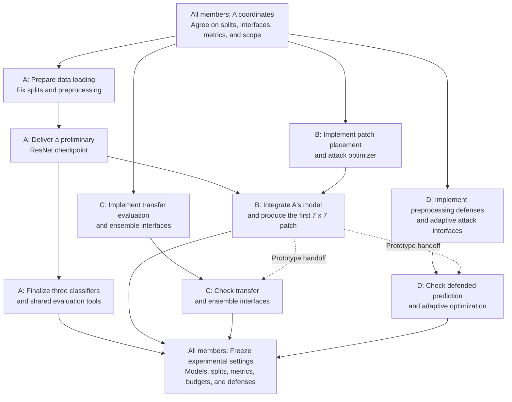
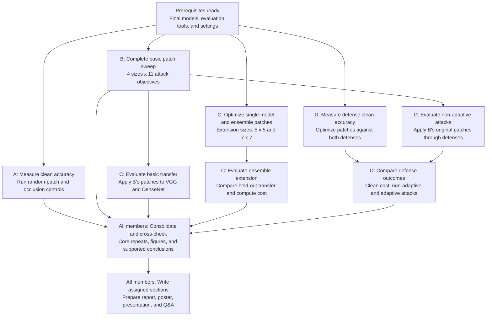

# Universal Adversarial Patches on CIFAR-10: Transferability and Adaptive Defense Evaluation

**Course:** ECE 661, Fall 2026  
**Selected topic:** Project 5 - Adversarial Patch Attack  
**Group:** Team 3  
**Team members:** 余希泰 (xy195), Member A; Russo Zhang (yz1047), Member B; 赵博毅 (bz138), Member C; 杨子江 (zy232), Member D  
**Proposal date:** October 25, 2026

## 1. What are we trying to do?

We will investigate how a small, shared image patch can cause CIFAR-10 classifiers to make incorrect predictions. Unlike an image-specific perturbation, a universal patch is optimized across training images and evaluated on previously unseen images. Our goal is to characterize the relationship between patch area, target class, model transferability, and defense effectiveness through reproducible experiments.

Our project will address three research questions:

1. **Attack effectiveness:** How do patch size and target class affect targeted and untargeted attack success, relative to ordinary occlusion?
2. **Transferability:** Does optimizing a patch jointly against multiple source models improve its effectiveness against a held-out architecture under comparable computational budgets?
3. **Defense evaluation:** How much do simple preprocessing defenses reduce attack success, and how does their apparent benefit change when patch optimization accounts for the defense?

Our four-person team will complete all basic requirements and two extensions: **ensemble-based patch optimization** and **preprocessing defenses evaluated with adaptive attacks**. Our contribution is a controlled empirical study of established methods on CIFAR-10.

## 2. How is it done today?

Brown et al. [1] introduced universal adversarial patches optimized over images, placements, and transformations. Their expectation-over-transformation approach encourages a patch to remain effective under changes such as translation, rotation, and scaling. The paper also investigates ensemble optimization and transfer across models.

Preprocessing can change an attack's effectiveness, but reduced success against an existing attack is insufficient to establish robustness. Athalye et al. [2] demonstrate that defenses can appear effective when they interfere with attack optimization, motivating evaluations in which the attacker accounts for the defended prediction pipeline.

We will adapt these ideas to small CIFAR-10 classifiers and study them under consistent data splits, attack settings, and evaluation metrics. This setting allows us to examine both attack performance and the cost of obtaining it within the course's resource limits.

## 3. What is our approach, and why do we think it will be successful?

### 3.1 Data, models, and experimental scope

We will use CIFAR-10 [3] at its original 32 x 32 resolution. We will create a fixed, stratified split of the official training set into 45,000 training images and 5,000 validation images, and reserve the official 10,000 test images for final evaluation. Classifier fitting and patch optimization will use only training images; hyperparameter selection and early stopping will use validation images.

We will train a ResNet-20 as the primary source classifier, a CIFAR-adapted VGG-11 with batch normalization, and a DenseNet-BC with depth 40 and growth rate 12. DenseNet will serve as the held-out architecture for the ensemble extension: its attack results will not guide patch optimization, ensemble weights, or hyperparameter selection. We will report classifier configurations and clean accuracy so attack results can be interpreted against model quality.

Experiments will use shared data splits, preprocessing, patch-placement rules, and evaluation code. Patches will be applied in pixel space before model normalization. We will document the nominal patch dimensions, transformation distribution, and actual coverage after transformation, and use matched settings across comparisons.

### 3.2 Basic requirements: universal patch attacks

Following [1], we will optimize a shared patch while freezing classifier parameters. Let $A(p,x,\tau)$ apply patch $p$ to image $x$ with sampled placement and transformation $\tau$. For target class $t$, we will minimize

$$
\mathcal{L}_{\mathrm{target}}(p)
=\mathbb{E}_{(x,y),\tau}\left[\mathrm{CE}\bigl(f(A(p,x,\tau)),t\bigr)\right].
$$

For untargeted attacks, we will maximize cross-entropy with the true label. Patch pixels will remain within the valid image range, and classifier parameters and normalization statistics will remain fixed during patch optimization.

We will evaluate nominal patch sizes of **3 x 3, 5 x 5, 7 x 7, and 16 x 16**, including untargeted attacks and targeted attacks for each of the ten classes. This produces 44 primary-source configurations per patch initialization. All resulting patches will also be evaluated on VGG and DenseNet to measure transferability. We will compare optimized patches with same-area random patches and constant-color occlusions using matched placements and transformations, and visualize learned patterns and representative failures.

### 3.3 Extension 1: ensemble optimization and transferability

We will compare patches optimized against ResNet alone, VGG alone, and an equal-weight average of the two models' attack losses. DenseNet will remain outside the optimization process. The extension will cover 5 x 5 and 7 x 7 patches, both attack types, and all ten targeted classes.

We hypothesize that jointly optimizing against two architectures may reduce dependence on source-specific features and improve held-out transfer. We will test this hypothesis rather than assume an improvement. Because each ensemble step requires additional computation, we will report optimization steps and elapsed time and include a comparison under matched elapsed-time budgets on the same hardware. Optimization budgets will be calibrated on validation data and fixed before final evaluation.

### 3.4 Extension 2: preprocessing defenses and adaptive attacks

We will investigate mild Gaussian blur and random resizing with padding. For each defense, we will measure clean accuracy, evaluate patches optimized without the defense, and then optimize new patches through the complete defended pipeline. Defense parameters will be selected on validation data and fixed before final testing.

For randomized preprocessing, adaptive optimization will estimate the expected loss over independently sampled defense transformations. Evaluation will likewise average success over repeated random draws. The defended predictor will perform one sampled preprocessing operation per prediction; repeated evaluation draws will estimate its behavior rather than introduce a separate voting defense.

We will examine whether reduced attack success persists after adaptation, together with the defense's clean-accuracy cost. For core configurations, we will increase attack iterations, restarts, or transformation samples to check whether weak optimization explains apparent robustness. Our conclusions will be empirical and restricted to the tested setting.

### 3.5 Evaluation and reproducibility

For classifier $f$, define the eligible set $S_f=\{(x,y):f(x)=y\}$. Untargeted ASR will be the fraction of this set misclassified after patch application. Targeted ASR for class $t$ will use $S_{f,t}=\{(x,y)\in S_f:y\ne t\}$ and measure the fraction predicted as $t$. We will report eligible sample counts, per-target results, and macro-averages across targets.

Defense comparisons will retain the same eligibility sets defined by the corresponding classifier without preprocessing. We will additionally report clean and patched accuracy over the full test set, making clean-performance losses visible. Randomized quantities will be estimated over repeated draws with the sampling procedure recorded.

Core comparisons will use at least three independent patch initializations, with means and variability reported. These repeats measure patch-optimization variability; claims about variability across independently trained classifiers will require separate model retraining. We will preserve checkpoints, patches, configurations, seeds, raw metrics, and timing records, and provide commands for reproducing the main tables and figures.

### 3.6 Team responsibilities

| Member | Main responsibility | Concrete deliverables |
|---|---|---|
| **A: 余希泰 (xy195)** | Data, classifier baselines, shared evaluation, and result auditing | Fixed splits; three model checkpoints and configurations; clean-accuracy and occlusion-control tables; validated metrics |
| **B: Russo Zhang (yz1047)** | Universal patch implementation and basic experiments | Targeted and untargeted optimization; complete size/class sweep; saved patches; attack curves and qualitative examples |
| **C: 赵博毅 (bz138)** | Transfer evaluation and ensemble extension | Basic cross-model transfer results; ensemble optimizer; held-out transfer and compute-budget comparisons |
| **D: 杨子江 (zy232)** | Preprocessing defenses and adaptive evaluation | Defense modules; clean-performance costs; adaptive patch optimization; defense and attack-strength comparisons |

Each member will write the methods and analysis for their experiments and review another member's results. A preliminary model and one working patch will be shared early so transfer and defense work can proceed before the full basic sweep is complete. All members will participate in poster preparation, presentation, and Q&A preparation.

## 4. What are the risks?

| Risk | Planned response |
|---|---|
| Small patches or targeted transfer achieve low ASR | Verify gradients and loss direction on a pilot; compare with occlusion controls; diagnose optimization on validation data; report failures alongside successful cases. |
| Ensemble gains come mainly from additional computation | Report both fixed-step and matched-time comparisons with the same data and transformation settings. |
| A defense appears robust because the attack is poorly optimized | Optimize through the defense, account for randomness, and check stronger attack budgets and independent restarts. |
| Classifier training and experiment sweeps exceed available resources | Benchmark early, reuse frozen models, batch evaluation, and prioritize the full basic matrix and the two defined extensions over additional ablations. |
| Evaluation choices produce misleading comparisons | Share metric code, record ASR denominators, preserve full-test accuracy, and keep test data out of configuration selection. |

The experiments will use public CIFAR-10 images and models controlled by the team. We will collect no new personal data, attribute reused code and methods, and limit conclusions to this digital benchmark.

## 5. How long will it take, and what resources are needed?

Implementation, experimentation, and analysis will run from October 25 through November 29, followed by presentation and report preparation.

| Dates, 2026 | Milestone |
|---|---|
| **Oct. 25-26** | Finalize interfaces and data splits, complete feasibility checks, and submit the proposal by Oct. 26, 11:59 p.m. Eastern Time. |
| **Oct. 27-Nov. 8** | Complete classifier baselines and the main patch implementation; run the basic attack and transfer matrix. |
| **Nov. 9-16** | Obtain initial ensemble and defense results; prepare the optional Nov. 16 TA check-in. |
| **Nov. 17-29** | Complete adaptive attacks, budget-matched comparisons, core repeats, and attack-strength checks. |
| **Nov. 30-Dec. 8** | Audit results, finalize figures, prepare the poster and report, and rehearse the presentation. |
| **Dec. 9** | Attend the in-person poster session, 1:00-4:00 p.m. Eastern Time. |
| **Dec. 10-11** | Incorporate feedback and submit the final report by Dec. 11, 11:59 p.m. Eastern Time. |

The project requires accelerator access for three CIFAR-scale classifiers and patch optimization, with storage for checkpoints and logs. We will use the course compute allocation within the group budget of up to $250. Generative-model API calls are unnecessary for the experiments. Runtime measurements will guide scheduling and resource use.

## 6. What are the final "exams" for success?

The project will be successful if we can deliver reproducible evidence addressing all three research questions, including negative findings where appropriate. Specifically, we will provide:

1. **Basic study:** all four sizes, untargeted attacks, ten targeted classes, patch visualizations, and cross-model transfer.
2. **Ensemble study:** held-out transfer and compute-matched single-model comparisons.
3. **Defense study:** clean-accuracy costs, non-adaptive attacks, and adaptive attacks.
4. **Reproducibility:** models, patches, configurations, seeds, metrics, timing logs, and documented execution commands.
5. **Presentation and report:** printed/PDF poster, all-member presentation, and a final report within the course page limit, with supplementary material.

Expected outputs include patch-size curves, target-class heatmaps, transfer matrices, and defense comparisons. Conclusions will be supported by measured results, including negative findings.

## AI Assistance Disclosure

Generative AI assisted with project-scope discussion, extension selection, task allocation, drafting, and document formatting. The authors retain responsibility for the submitted content, including methods, references, code, and claims. The final report will disclose subsequent AI use and the procedures used to verify AI-assisted work.

## References

1. Tom B. Brown, Dandelion Mané, Aurko Roy, Martín Abadi, and Justin Gilmer. **Adversarial Patch.** arXiv:1712.09665, 2017. [Paper](https://arxiv.org/abs/1712.09665).
2. Anish Athalye, Nicholas Carlini, and David Wagner. **Obfuscated Gradients Give a False Sense of Security: Circumventing Defenses to Adversarial Examples.** ICML, 2018. [Paper](https://arxiv.org/abs/1802.00420).
3. Alex Krizhevsky. **Learning Multiple Layers of Features from Tiny Images.** Technical report, 2009. [CIFAR-10 dataset and report](https://cave.cs.toronto.edu/kriz/cifar.html).

## Appendix. Workflow and dependencies

Solid arrows indicate prerequisite deliveries; dashed arrows indicate early prototype handoffs. Independent branches can proceed concurrently within the available compute capacity. Roles A-D correspond to the named team members in Section 3.6.

**Stage 1: Development and integration.** A delivers an initial ResNet checkpoint while completing the three final classifiers. B shares the first working 7 x 7 patch so C and D can check their pipelines before the basic sweep is complete.

**Stage 2: Experiments and evaluation.** With models and settings finalized, controls, basic attacks, ensemble optimization, and adaptive optimization proceed in parallel. C and D receive B's original patches in batches for transfer and non-adaptive defense evaluation.

C's ensemble optimization and D's adaptive optimization do not require B's full sweep. Each handoff includes model and patch files, preprocessing, objective, size, transformations, seed, and optimization budget. Final measurements use fixed settings; DenseNet attack results do not guide method selection.
